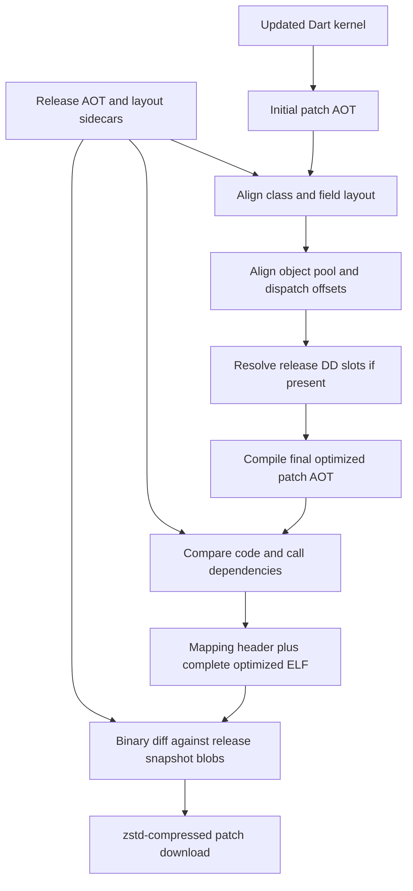

# Shorebird aot-tools: downloaded artifacts, measured behavior, and design

Study date: **2026-11-04, Asia/Shanghai**.

**Result:** downloaded the real upstream tools, compiled Flutter/iOS-targeted
snapshots, ran 13 successful links, and reconstructed all 13 compressed patch
downloads byte-for-byte. This replaces the earlier *not executed* research status
in `AOT_TOOLS_BLACKBOX.md`. No workspace implementation was changed.

Shorebird preserves performance primarily by **reusing compatible native code
from the installed release**, after recompiling the patch to preserve the
release's layouts. It keeps downloads small through a **separate binary-diff and
compression stage**. Neither mechanism guarantees unchanged installed size or
runtime performance.

## 1. Download and reproduction

All task-controlled downloads, extracted tools, temporary directories, caches,
fixtures, logs, and outputs are on the external disk:

```text
/Volumes/TonyCL6APFS/git/shorebird-workspace/.agents/aot-tools-exploration/
```

The directory occupies approximately 1.4 GiB, including the matching SDK and
retained intermediate snapshots. `env.sh` redirects TMPDIR/TMP/TEMP, XDG caches,
Pub, Cargo, and compiler cache locations into this directory. Dart kernels run
directly with `--disable-dart-dev`; no package installation was needed.

Pinned provenance:

| Item | Value |
| --- | --- |
| Flutter revision resolved from upstream CLI `flutter.version` | `8352242a910a1f79747cb1c6d2aa02edc5f3fc12` |
| Corresponding `bin/internal/engine.version` | `eaeb4bdcae57b971d6dd7507a3b53e61676b8330` |
| Dart SDK | 3.13.7 stable |
| `aot-tools --version` | 0.0.1; pin the engine revision as well |
| Tool kernel size | 24,185,976 bytes |
| Tool SHA-256 | `c11d845894faf51b6f95548089685e8226bdb2c77950261c4d87f7fbcfbcead8` |
| Snapshot target features | product, arm64, ios, no compressed pointers |

The artifact URL is
`https://download.shorebird.dev/shorebird/<engine-revision>/aot-tools.dill`.
Using the Flutter revision in that position returned 404. The workspace's own
Dart SDK rejected this kernel with format-version 139 versus 138; the matching
downloaded SDK ran it successfully. Matching the compiler, analyzer, platform
kernel, and tool is essential.

`manifest.json` records all five downloads, redirected URLs, byte lengths, and
SHA-256 hashes. Every download also matched the MD5 provided by GCS response
metadata. Matching artifacts downloaded: Dart SDK, iOS release tools, Flutter
product platform kernel, and the upstream `patch` packager. The tools are
distributed binaries; this study did not obtain or decompile their source.

Key local evidence, relative to the study directory:

| Path | Contents |
| --- | --- |
| `downloads/aot-tools.dill` | Actual downloaded tool |
| `manifest.json` | Download provenance and hashes |
| `env.sh`, `run_study.py` | Environment and reproducible experiment driver |
| `audit_study.py` | Public bidiff decoder and artifact/accounting checks |
| `results/audit.json`, `logs/audit.log` | All 13 final measurements and verification results |
| `logs/commands.jsonl` | Commands, exit codes, working directories, elapsed build times |
| `logs/help-*.txt` | Tool command help |
| `results/{direct,dd,direct_wide,dd_wide}/` | Sources, kernels, snapshots, link maps, traces, diagnostics, downloads |
| `sources/` | Public Flutter integration files extracted at the exact pinned revision |

Reproduce the measured matrix after downloads/extraction. Prerequisites are
Python 3 and the `zstd` command on PATH; this machine's existing
`/opt/homebrew/bin/zstd` was used for reconstruction checks.

```sh
cd /Volumes/TonyCL6APFS/git/shorebird-workspace
source .agents/aot-tools-exploration/env.sh
python3 "$AOT_STUDY_ROOT/run_study.py" p0_identical p1_string p2_one_caller p3_shared_leaf p4_field_layout p5_new_function
python3 "$AOT_STUDY_ROOT/run_study.py" --dd p0_identical p3_shared_leaf
python3 "$AOT_STUDY_ROOT/run_study.py" --wide p0_identical p3_shared_leaf
python3 "$AOT_STUDY_ROOT/run_study.py" --dd --wide p0_identical p3_shared_leaf p6_remove_caller
python3 "$AOT_STUDY_ROOT/audit_study.py"
```

Run serially: fixtures intentionally compile from one canonical source URI.
Different source paths can change function identities. Variant sources are
preserved alongside their outputs. The initial exploratory files under
`preliminary/` are excluded: using the same basename for base and patch caused
debug-file collisions. The final runs use `App.aot` versus `out.aot`, and their
metadata percentages agree with the live link results.

## 2. What the linker actually does

The tool exposes `compile`, `link`, `dump_blobs`, `query_snapshot`,
`field_table_diff`, `link_stats`, `link_metadata`, and `link_diagnostics`.
The verbose `link` output records the subprocesses below; these stages were
executed, not merely inferred from comments.



### Release compilation

The release remains an optimized, tree-shaken AOT program. The fixture frontend
used `--aot --target=flutter --target-os=ios -Ddart.vm.product=true`; normal type
flow analysis remained enabled. Native compilation used `--deterministic`.
There is no requirement to disable global optimization or retain all unreachable
code just to make a release patchable.

However, “identical to stock AOT with zero extra indirection” is too strong.
Shorebird can add selective **DD (dynamic dispatch) slots** to the release.
The public release pipeline first builds an analysis ELF and function identity
file, computes a DD table plus caller links and slot mappings, then recompiles
with `--dd_slot_mapping`. The studied DD configuration used the public CLI's
10,000-byte transitive-caller threshold. These selected indirect calls trade
some release code/table space and call overhead for better future native reuse.

The build also emits `.ct.link`, `.ft.link`, `.dt.link`, and optional DD files.
These are build/link sidecars stored with the release supplement; their sizes
must not be counted as if they were all added to the installed app.

Evidence: pinned `sources/build.dart`, especially lines 209–238, 328–363,
420–533; `logs/dd_wide-base-*.log`; the upstream CLI argument semantics in
`shorebird/packages/shorebird_cli/lib/src/common_arguments.dart`.

### Patch layout stabilization

Even unchanged source may generate different instructions if a class ID,
instance/static field offset, object-pool index, or dispatch-table offset moves.
Global optimization and inlining can also change callers far from a source edit.
Simply comparing function names or raw whole-file bytes cannot solve this.

Observed passes:

1. Extract the base object-pool link data with `analyze_snapshot`.
2. Generate `out.ct.aot` using `--base_ct_link_data`,
   `--patch_ct_link_data`, and `--base_ft_link_data`.
3. Extract the intermediate object-pool link data. Generate
   `out.preDdOptimized.aot` with base/patch object-pool data, base dispatch
   offsets, and the previous class/field constraints.
4. If the base contains DD artifacts, compute patch DD slot mappings against
   the release's DD table and caller links. If not, this tool explicitly logs
   that it leaves DD inactive because the release contains direct branches.
5. Generate `out.ddOnly.aot` with DD activation and extract its object-pool
   data. Generate `out.optimized.aot` with the combined layout and DD inputs.
6. Analyze base and final patch, emit the native-reuse mapping, and package it
   with the final ELF as `out.vmcode`.

The logs expose actual object-pool movement and dispatch-row retention counts.
For the identical control, all 124 considered dispatch rows retained their
offsets and zero of 1,742 object-pool entries moved. These counts belong to
this small fixture, not to arbitrary Flutter applications.

Evidence: `logs/direct-p0_identical-link.log` and
`logs/dd_wide-p3_shared_leaf-link.log` contain the complete commands.

### Reuse includes call dependencies

The analyzer exports each compiled code entry's size, offset, `self_hash`,
`subgraph_hash`, `op_subgraph_hash`, callees, object-pool references, field-table
references, selectors, and DD slots. It analyzes compiled code entries,
including stubs and generated functions, rather than just source methods.

Changing `sharedLeaf` left `caller17`'s own hash unchanged but changed its
subgraph hash. With direct calls, that caller was absent from the native reuse
map. Its old branch would otherwise keep reaching the old implementation.
DD interrupts this propagation at selected indirect boundaries.

Changing only the displayed string retained **100% native code** while the new
string appeared in the patch's object pool. This supports the interpretation
that stable pool access instructions can execute against updated snapshot
data; instruction reuse does not require every constant's value to remain
identical. Precise runtime register/pool rebinding remains inside the private
VM implementation.

The hash fields and observations establish graph-aware reuse, but do not expose
the complete hash-normalization algorithm, collision handling, or equivalence
proof. Do not claim source-level identity alone is sufficient.

## 3. Measurements

The test app imports `dart:ui`, draws a paragraph, and has an intentionally
controlled graph of non-inlined callers and a model/helper. It uses Flutter's
product platform kernel and the actual iOS ARM64 snapshot generator. It is
not a Material app, signed IPA, or representative production benchmark.

### Eighty callers, release without DD

Release ELF: **1,046,072 bytes**. Release data/text diff-base blob:
**792,218 bytes**. All sizes below are bytes.

| Source change | Native code reuse | Unlinked code entries | Unlinked code bytes | Download | Installed vmcode |
| --- | ---: | ---: | ---: | ---: | ---: |
| None | 100.00000% | 0 | 0 | 83,639 | 1,062,464 |
| Displayed string | 100.00000% | 0 | 0 | 85,035 | 1,062,464 |
| One caller's integer argument | 99.15865% | 8 | 3,544 | 83,640 | 1,062,464 |
| Shared helper arithmetic | 98.16536% | 89 | 7,728 | 83,566 | 1,062,464 |
| Add a runtime-valued instance field and use it | 98.00547% | 91 | 8,404 | 113,122 | 1,062,600 |
| Add and invoke a function | 99.70944% | 7 | 1,224 | 107,522 | 1,062,544 |

Link percentage was verified as:

```text
100 * linked_code_size / patch_code_size
```

The denominator equals the sum of the analyzer's code-entry sizes in every
run. It is **not function count, ELF size, source percentage, or time spent on
the CPU**. A small unlinked hot loop can matter much more than its byte share.

### Three hundred twenty callers: the DD tradeoff

The same shared-helper edit was compiled against two releases of identical
source and kernel, with and without DD. Threshold: 10,000 bytes.

| Metric | Direct release | DD release |
| --- | ---: | ---: |
| Release ELF | 1,117,504 | 1,134,040 |
| Release compiled code bytes | 440,428 | 451,808 |
| Patched native code reuse | 93.88595% | 99.98141% |
| Unlinked entries | 329 | 2 |
| Unlinked code bytes | 26,928 | 84 |
| Compressed download | 88,274 | 90,208 |
| Installed vmcode | 1,133,896 | 1,166,824 |

DD added **16,536 bytes (about 1.48%)** to this release ELF. The two remaining
unlinked entries were `Model.evaluate` (52 bytes) and `sharedLeaf` (32 bytes).
The caller cascade shrank dramatically, while the download grew by 1,934 bytes.
Thus improved native reuse and smaller downloads are separate objectives.

In the 80-caller version, DD at the same threshold barely improved the helper
case: 98.16536% to 98.19053%, with 89 unlinked entries in either case. That
smaller caller graph did not receive the same useful indirect boundary.

A further DD-wide experiment removed the call to `caller17`, allowing TFA to
remove the function. The tool reported 13 unresolved sentinel slots and
explicitly **withheld seven base functions** from linking. Reuse was
97.18050%. DD does not make arbitrary structural edits cost-free; its safety
checks must also prevent native code from reaching an unresolved target.

Evidence: `results/audit.json`, each case's `link.jsonl`, analyzer JSON and
`debug/link_table.txt`, plus `logs/dd_wide-p6_remove_caller-link.log`.

## 4. What is actually in a patch

For all 13 generated files, direct byte inspection verified:

```text
out.vmcode = mapping header + zero padding + the complete out.optimized.aot
```

For this tool revision, the header begins with a little-endian 32-bit mapping
count, followed by pairs of 32-bit patch/base instruction offsets. Their
multiset exactly matches the tool's textual link table. The order differs
from the textual table, so comparing lists in their original order is wrong.
ELF begins at byte 16,384 or 32,768 in these cases; its ELF machine value is
183 (AArch64). The payload after that offset equals the entire optimized ELF
byte-for-byte. This is a measured description, not a stable format contract.

The tool's diagnostic line `LinkTable (padded) size: 65536 bytes` did not match
the actual 16,384-byte header in the small cases. The audit uses file bytes,
not that log message, for header sizing.

The separate upstream `patch` executable takes the release snapshot blob and
the new vmcode, creates a bidiff stream, and compresses it with zstd. The
download is reconstructed into the full vmcode on device. A tiny network
patch therefore does not mean the installed patch contains only changed
function bodies. Even the unchanged control has a nonempty download because
the target includes a container/mapping header and ELF representation, while
the diff base is concatenated snapshot data/text.

`audit_study.py` decompresses the downloads with zstd, applies the public
bidiff v0x1000 controls to the exact base blob, and compares every resulting
byte to `out.vmcode`. **All 13 round trips passed**, including SHA-256 equality.
It also validates code-size accounting, link mappings, ELF equality, and zero
header padding. The public decoder format was checked against the installed
`bipatch` 1.0.0 and `bidiff` 1.0.0 Rust sources; no third-party package was
installed for this audit.

The public updater source inspected at `cb1ddcbf...` uses zstd level 21;
the exact encoder settings of the downloaded packager are not established by
that separate checkout. The actual downloaded packager's outputs, rather than
an assumed compression level, supply the measurements above.

## 5. Runtime path and performance boundary

The matching public Flutter source confirms the iOS integration:

- `sources/shorebird.cc:83` retains the release data/text mappings and passes
  them to `Shorebird_SetBaseSnapshots`. Separate VM arguments are null in this
  revision because the VM/isolate snapshot representation has merged.
- `sources/shorebird.cc:302` registers the base and prepends the selected
  patch path, retaining access to the base image for linked execution.
- `sources/patch_cache.cc:19` maps vmcode read-only, calls
  `Shorebird_ReadLinkHeader`, and loads its ELF at that offset with
  `dart::bin::kReadOnly`.
- `sources/dart_snapshot.cc:160` attempts patched isolate data resolution.
  The symbols are now `kDartSnapshotData` and `kDartSnapshotText`.
- `sources/config.gni:74` enables this interpreter path for iOS. Other
  platforms use a different loading path; these results should not be
  generalized to Android or macOS patch execution.

The resulting model is: compatible code executes from the installed signed
native image; changed or otherwise unlinked code uses the interpreter, with
transitions between those paths. Our patch payloads are AArch64 AOT ELF,
not Dart source or an ordinary Dart bytecode file. Historical maintainer
accounts describe ARM64 CPU/simulator transitions. The precise current
interpreter, GC/unwind transitions, and runtime dispatch implementation live
behind private Dart hooks and were not independently inspected here.

There is no basis here for claiming zero runtime overhead, an exact per-call
nanosecond cost, unchanged startup, or unchanged memory use. DD changes selected
calls, interpreter transitions cost work, and a downloaded patch coexists with
the installed base. The size of mapped files alone is not resident-memory use.
Link/build wall times in the logs are host tool timings, not app benchmarks.

Shorebird's current [architecture documentation](https://docs.shorebird.dev/architecture/)
describes per-function native reuse on iOS, while its
[performance documentation](https://docs.shorebird.dev/code-push/performance/)
explains that compiler optimization can cause non-local changes and slow
patches. Those are consistent with the measured caller cascade. Actual CPU
time, frame times, startup latency, and memory require release-mode device
tests of the specific application and patch; none was run in this study.

## 6. Implications for this workspace

The evidence supports pursuing these properties in an independent design:

1. Keep normal AOT optimization and tree shaking for the release; avoid making
   every function dynamically dispatched solely for patchability.
2. Treat stable class IDs, field layouts, dispatch offsets, and pool slots as
   first-class build outputs. Recompile against release layouts.
3. Decide native reuse using compiled behavior and dependencies, including
   direct callees and unresolved dispatch slots. Source names alone are not a
   safety condition.
4. Select indirection where it reduces large caller cascades; measure its
   release-size and runtime cost. A threshold can help some graphs and do
   little for others.
5. Track download bytes, installed bytes, compiled-code bytes, native reuse,
   and actual hot-path performance independently.
6. Retain versioned release sidecars and compiler settings. Our initial SDK
   format mismatch demonstrates why toolchain compatibility cannot be guessed.

This study does **not** implement these mechanisms in the workspace's own
runtime, prove compatibility with its patch format, or validate a signed app
on hardware. It provides reproducible upstream artifact evidence to guide that
work.

## 7. Corrections to the earlier study

- Download/execution is now complete; the older stopped-at-terms document is
  a historical record, not the current research status.
- Release AOT can include selective DD indirection; “stock AOT plus dumps”
  and universal zero-cost call claims are overstatements.
- Current snapshot loading uses a data/text pair and an owned patch cache,
  rather than the older four-blob/permanently-leaked-ELF path.
- A public source comment says a linked patch carries only rewritten code;
  the measured files contain the complete optimized ELF. Runtime reuse and
  physical omission of code must not be conflated.
- Link percentage is demonstrably code-byte weighted in this tool version.
- DD activation is conditional on the base's artifacts. This tested tool
  leaves DD inactive for a base without them; older fallback descriptions
  should not be treated as current behavior.
- Exact DD algorithms and interpreter internals are still not exposed by the
  open integration source. Observed logs are not a substitute for that source.

Primary public source links at the matched Flutter revision:
[compiler integration](https://github.com/shorebirdtech/flutter/blob/8352242a910a1f79747cb1c6d2aa02edc5f3fc12/packages/flutter_tools/lib/src/base/build.dart),
[patch ELF loading](https://github.com/shorebirdtech/flutter/blob/8352242a910a1f79747cb1c6d2aa02edc5f3fc12/engine/src/flutter/runtime/shorebird/patch_cache.cc),
[base-image retention](https://github.com/shorebirdtech/flutter/blob/8352242a910a1f79747cb1c6d2aa02edc5f3fc12/engine/src/flutter/shell/common/shorebird/shorebird.cc),
[snapshot symbols](https://github.com/shorebirdtech/flutter/blob/8352242a910a1f79747cb1c6d2aa02edc5f3fc12/engine/src/flutter/runtime/dart_snapshot.cc).
