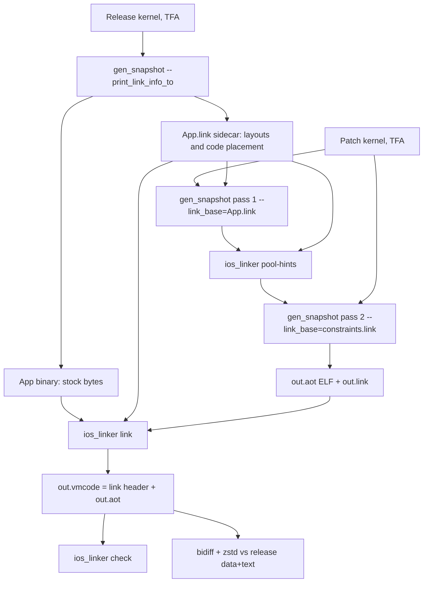

# iOS native-reuse code push: compiler and linker

Status 2026-11-04. Implemented and validated on host gen_snapshot builds
(product AOT, arm64) in three configurations: the iOS configuration (no
compressed pointers, which is what Flutter iOS uses), compressed pointers,
and the iOS engine's Shorebird defines (section 9.4). iOS releases are read
from the real `App.framework/App` Mach-O built the way flutter_tools builds
it (section 6.1). The runtime half
(native execution of linked code, ARM64 simulation of the rest) is described in
[`RUNTIME.md`](RUNTIME.md). This document owns the release/patch layout
contract, the link table and the `vmcode` container; section 6 is the format
the runtime consumes.

This is an independent implementation. The only inputs from Shorebird's
closed `aot-tools` are the black-box observations in
[`../AOT_TOOLS_EXPLORATION.md`](../AOT_TOOLS_EXPLORATION.md). Public design
notes are in [`../UPSTREAM_SHOREBIRD_PATCH_DESIGN.md`](../UPSTREAM_SHOREBIRD_PATCH_DESIGN.md).
No closed code was copied, decompiled or reverse-engineered.

Code:

- Dart SDK branch `tonycloud/ios-aot-linker-20261104` (base `2513af5688a`):
  - `runtime/vm/compiler/aot/link_info.{h,cc}`: keys, sidecar reader/writer, static field remap, DD target set.
  - `runtime/vm/class_finalizer.cc`: class ids.
  - `runtime/vm/object.cc`: field offsets.
  - `runtime/vm/field_table.{h,cc}`: static field ids.
  - `runtime/vm/compiler/assembler/{object_pool_builder.h,assembler_base.cc}`: pool slots.
  - `runtime/vm/compiler/aot/dispatch_table_generator.cc`: selector offsets.
  - `runtime/vm/compiler/backend/flow_graph_compiler_arm64.cc`, `inliner.cc`: DD calls.
  - `runtime/vm/image_snapshot.cc`: code placement.
  - `runtime/vm/compiler/aot/precompiler.cc`: hooks.
- `tools/ios_linker/` in this repository: the analyzer, linker, checker,
  pool-hint pass, DD selection and experiment drivers (pure Dart, no packages).

## 1. Summary

| Step | What happens |
| --- | --- |
| Release | Normal TFA-optimized AOT. `--print_link_info_to=App.link` writes the layout sidecar. The release binary is **byte-identical to stock** (verified for all three test programs). Optional `--link_dd_targets` adds DD slots. |
| Patch | A complete optimized AOT snapshot of the new program, compiled twice with `--link_base`. Pass 1 uses the release sidecar. Pass 2 uses the release sidecar plus pool hints from pass 1. |
| Link | `ios_linker link` compares every compiled code entry of release and patch and writes `out.vmcode` = link header + the patch ELF. The release is the shipped `App.framework/App` (Mach-O) or an ELF. `--min-link-percent` refuses to write a vmcode below a threshold. |
| Check | `ios_linker check` re-verifies the table from the two binaries alone, word by word and branch by branch. |
| Download | Updater `patch` tool (bidiff + zstd) of `out.vmcode` against the release data+text blob. |

Results (section 9; identical in every configuration within 0.2 points):
identical patches link 100%; changing a displayed string
links 100%; one caller edit 99.1%; a shared helper behind 80 callers 97.9%.
Behind 320 callers it is 93.0% without DD and 99.99% with DD (only the helper
itself, 32 bytes, stays unlinked). On the real Flutter app
(`testapps/patch_perf_bench`, normal TFA kernel) edits link 99.3–100%. Every
link table passed the independent checker.

## 2. Model



The central invariant is simple. **At run time every table comes from the
patch snapshot.** That covers the global object pool (PP), the dispatch table,
the class table, the static field table and the object store. The release
contributes only machine instructions. Release code therefore executes
*exactly* the patch's semantics whenever its instructions are byte-identical
to the patch's own compilation of the same entry, apart from direct branch
displacements, which are handled separately. The layout constraints in
section 3 exist only to make that byte identity likely. They are never needed
for correctness.

## 3. Release facts and patch constraints

### 3.1 Sidecar (`App.link`)

The sidecar is line-oriented, tab-separated, UTF-8. Keys never contain tabs
or newlines. The first line is the format version, `#osb-link-info 2`;
the next two lines identify the compiler:

```
#osb-link-info 2
id	snapshot_hash	3ad6e28b542fa7486e0b0fce6bbd5671
id	features	product no-asan no-msan no-tsan no-shared_data no-code_comments no-dwarf_stack_traces arm64 macos no-compressed-pointers
```

- **Version policy.** The version changes whenever a line kind or column
  meaning changes. gen_snapshot (`--link_base`) and `ios_linker` accept only
  their own version and fail with a message naming both versions. Version 1
  (no identity lines) is rejected.
- **Identity.** `snapshot_hash` is `Version::SnapshotString()` and
  `features` is the AOT snapshot features string (mode, sanitizers, arch,
  target OS, compressed pointers). `--link_base` aborts unless both equal the
  running gen_snapshot's, and `ios_linker link`/`check`/`pool-hints` refuse a
  release and patch sidecar that differ (exit 4). A layout recorded by one
  compiler is never interpreted by another.
- **Determinism.** The sidecar contains no paths of its own, timestamps or
  addresses. Two runs on the same kernel produce byte-identical sidecars, and
  the ELF run and the assembly run (`--snapshot_kind=app-aot-assembly`)
  produce the same bytes (verified for every release in section 9).

| Line | Columns | Recorded when |
| --- | --- | --- |
| `id` | `snapshot_hash` or `features`, value | first |
| `meta` | name, value (`num_cids`, `num_statics`, `stub_pool_length`, `pool_length`, `dispatch_table_size`, `text_image_size`) | as produced |
| `class` | cid, class key, instance size, next field offset, type-arguments offset, super cid, **subtree end** | after class finalization and id assignment, **before tree shaking** |
| `field` | offset, unboxed size (0 = boxed), field key | same |
| `static` | field id, field key | same, from a heap walk over all `Field`s |
| `selector` | selector id, offset, selector key | after dispatch table layout |
| `pool` | index, entry type, patchability, key (empty = unused release slot) | after compilation |
| `uses` | function code key, comma list of pool indices requested in order | per successful function compile |
| `code` | image symbol, payload offset in the text image, payload size, code key | while the text image is written |
| `call` | owning code offset, return-pc offset, call kind, entry kind, target key | from the code's static call table |

Layout facts are recorded before the precompiler drops classes and fields. A
field or class that the release tree-shook still determined the offsets of
the code that was kept. Recording earlier was the fix that took identical
patches from 28% to 100%.

The sidecar is 0.86–1.0 MB for the fixtures and 3.6 MB for the Flutter app
(93–323 KB with `zstd -19`). It belongs in the release supplement, not in the
app.

Keys (`LinkInfo::*Key`):

| Entity | Key |
| --- | --- |
| Class | `library-url::ScrubbedName` |
| Field | `class key::[static:]name` |
| Function | `class key::name#kind/numParameters[s]`. A closure is keyed by its parent's key plus the closure name and its token offset relative to the outermost function. A tear-off is `parent::<tearoff>`. |
| Code | `fn:` function key; `alloc:` class key; `tts:` type key; `stub:` stub name |
| Selector | `name\|function kind\|smallest declaring class key\|order-independent hash of all declaring classes`. Remaining collisions are numbered in selector-id order. |
| Pool constant | content keys: `str:` length + FNV-64 of UTF-16 units; `int:`, `double:` bits, `type:` / `targs:` structural, `tparam:` class and index, `field:`, `function:`, `code:`, `closure:`, canonical `array:`, `ucall:` / `icdata:` / `mega:` selector + arguments descriptor, and `const:` class + canonical hash |
| Pool entry without a stable content key | `site:<function key>#<n>`: the n-th pool request of that function's code. This covers patchable call-site entries, native-call slots, non-canonical (identity) objects and function type parameters. |

Source URIs are part of identities. Release and patch must compile the app
from the same URIs. This is true for `package:` URIs; the fixtures use one
canonical file path.

### 3.2 Class ids

`ClassFinalizer::AssignClassIdsFromLinkBase` replaces `SortClasses` when
`--link_base` is set:

- Every class whose key is in the release keeps its release cid.
- All other classes get cids after the release's range, in hierarchy
  preorder (the same order `SortClasses` uses, for compact subtype ranges).
- Release cids that are unused by the new program stay as holes. The class
  table is grown first and the permutation completed with the empty rows.
  Holes are already normal in AOT, since `DropClasses` creates them.

Holes inside a cid range keep range checks valid, because no instances exist.
A new subclass outside its parent's range forces the patch's own range checks
to change, so those functions simply do not link. The patch's compilation is
always made with the patch's real cids.

### 3.3 Instance fields, unboxed fields, type arguments

`Class::CalculateFieldOffsetsFromLinkBase`:

1. Mark the words used by the header, by every ancestor field and by
   ancestors' type-argument fields, using their actual patch offsets.
2. A field whose key exists in the release keeps its release offset if
   - its representation is unchanged (boxed, or unboxed with the same size,
     from TFA's unboxing metadata via `is_unboxed` and `guarded_cid`),
   - the words are free, and
   - an unboxed field still fits the unboxed-field bitmap.
3. A class that introduces type arguments keeps the release type-arguments
   offset under the same rule.
4. Everything else is placed at
   `max(super end, end of placed fields, release subtree end of this class)`.
   - This covers new fields, fields whose unboxing changed, and fields whose
     words are taken.
   - The *subtree end* is the largest next-field offset of the class and all
     of its release subclasses. A field added to a superclass therefore can
     never collide with a subclass field that keeps its release offset.
5. Instance size = rounded end. Unused words are tagged slots initialized to
   null by allocation, so the GC sees null.

A field the release boxed although it is unboxable now is boxed in the patch
too (boxing is always valid). The stock layout boxes unboxable fields that
end past the unboxed-field bitmap: 64 words, which is 256 bytes with
compressed pointers and 512 without. Without this rule the compressed build
linked `dart:ui`'s `PointerData` (scale and rotation at 256/260) at new
offsets, and an *identical* Flutter patch linked only 99.69%; with it, 100%.
`test/runtime/v3.dart`/`v4.dart` (a 40-double class) cover it at run time.

Measured: adding a field to `Model` changed only the code that allocates or
reads `Model` (p4). The runtime fixture added two fields (double and int) to
a superclass with a subclass; the patch's output matched stock.

### 3.4 Static field table

`LinkInfo::RemapStaticFieldIds` runs right after class ids, before any code
is compiled:

- It collects every static `Field` object, including clones, by heap walk.
- Fields known to the release get their release id. Other fields are
  appended after the release's count.
- Values in the initial, sentinel and isolate field tables move with the
  ids (`FieldTable::Remap`). Unused ids hold the sentinel.

An earlier dictionary-based version missed fields and left stale ids, so the
heap walk is required.

### 3.5 Global object pool

PP is the patch's pool. Base code is correct with any pool *contents*,
provided its indices are equal. Constraints:

1. **Reservation.** After the shared stub entries (identical for one SDK), the
   patch reserves `[stub_pool_length, release pool_length)` and fills it with
   immediate-0 placeholders. An entry whose key maps to a free release slot is
   placed there; all other entries are appended after the reserved range
   (`ObjectPoolBuilder::TryPlaceAtLinkSlot`). Unused release slots stay as
   zero immediates (8 bytes each).
2. **Pairs.** Patchable entries are allocated in adjacent pairs that one `ldp`
   loads (switchable call stub + data, native call entry + target, type-test
   cache + name). A patchable entry is placed only if the next slot is free
   too, and a patchable request immediately following a placed one goes into
   that next slot. One half of a pair can never be placed while the other is
   appended.
3. **Reachability.** Per-function compiles use a child builder whose entries
   form the per-`Code` "local pool". The precompiler and the AOT serializer
   use that local pool to decide which global entries are live. Placed entries
   are therefore also recorded as used-from-parent. Without this, the serializer
   silently dropped live objects (static field initializers, allocation stubs,
   type-test stubs) and the patch shrank by 107 KB.
4. **Second pass** (`ios_linker pool-hints`). The patch's pass-1 compilation
   records which pool indices each function requested, in order. For a
   function present in both builds with sequences of equal length, if position
   *j* uses release slot *b* in the release but an appended slot in the patch,
   and *b* is a hole in pass 1 with the same entry type, the hint assigns that
   patch key to *b*. Pairs move together. Pass 2 compiles with these hints.
   This is how a changed string reaches 100%: the new string takes the old
   string's slot, so the code using it is byte-identical and loads the new
   value through PP.

### 3.6 Dispatch table

Selector rows are fitted most-popular-first at their release offsets
(`fitter.FitAndAllocate(row, off, off)`), before the normal passes. A row that
no longer fits there (new cids extend it into a neighbour) is placed normally.
Code calling it then differs and does not link. The table itself is the
patch's; its entries point at patch `Code`, which the runtime maps to release
entry points or gates. New classes get cids after the release range, so a row
grows at its end.

Possible improvement: reserve a trailing cid window per popular row. Upstream
release notes mention this. It was not needed for these tests.

### 3.7 DD slots (release-time indirection)

With `--link_dd_targets=<file>` (one function key per line), every static call
to a listed function is emitted as follows (`GenerateStaticDartCall`):

```
ldr  x0, [pp, #slot(Function)]     ; FUNCTION_REG, pinned pool slot
ldr  lr, [x0, #Function::entry_point]
blr  lr                            ; checked entry
```

This replaces `bl target`. DD targets are never inlined. The `Function` is a
pool constant with a content key, so it keeps its slot. The caller's bytes no
longer depend on the callee's code. At run time the slot holds the *patch's*
`Function`, whose entry point the runtime sets to the release code (if linked)
or a gate. The same target file must be passed to the release and to every
patch build; it is part of the supplement. No sentinel slots exist. A DD
target removed by a patch is no longer called by any patch code, so release
code calling it cannot be linked (it would differ).

## 4. Code-entry identity analysis and the link rule

`tools/ios_linker/lib/src/linker.dart` analyzes every code entry in both text
images: functions, stubs, allocation stubs, type-testing stubs and
dispatchers. Its unit is the instructions payload, at a 4-byte granularity.

### 4.1 Normalization

The analyzer decodes every instruction word.

- **B/BL whose target leaves the entry** (direct calls and tail calls). The
  26-bit displacement is cleared and replaced by *(target entry,
  offset into target)*.
  - Each such branch must also appear in the compiler's static call table
    (the `call` lines). Otherwise the entry is unlinkable, because data can
    decode as a branch.
  - A target outside every entry (a trampoline) makes the entry unlinkable.
- **Branches, ADR and literal loads inside the entry** are compared as raw
  bytes. Their relative displacement is layout-independent.
- **ADRP, or ADR / conditional branch / literal load leaving the entry**: the
  entry is unlinkable. None occurred in the tests.
- **Not normalized: pool indices, field offsets, cids, selector offsets,
  static field ids, thread offsets, instance sizes, tags, immediates.** These
  are bytes and must be equal. Normalizing pool indices would be unsound,
  because PP is shared: base code would read the wrong slot.

### 4.2 Link rule (greatest fixpoint)

Patch entry P links to release entry B iff all of the following hold:

1. **Pairing.** B has the same key as P (unique in both builds). If P's key
   is unknown or ambiguous, B is the unique release entry with the same
   normalized content.
2. **Self equality.** The normalized bytes are equal, and the outgoing
   branches are at the same offsets, of the same kind (BL or B), and at the
   same offset into their targets.
3. **Callees.** For every outgoing branch *k*, P's target is itself linked to
   B's target. This is computed as the greatest fixpoint: start from all
   candidates and remove until stable. Mutually recursive groups whose
   members are all identical therefore link together.

The analyzer also exports a *self hash* (FNV-64 of the normalized bytes and
branch shape). It computes a *subgraph hash* by hashing Tarjan SCCs in
callee-first order over self hashes and callee subgraph hashes. These are
diagnostics: in all 40 measured cases every linked pair also had equal
subgraph hashes (`subgraph_hash_agreements` = `linked_entries`). Pool constants, field-table and dispatch
references do not enter the hash. They are already bytes of the entry, and
their *values* are the patch's at run time by construction. Stubs and
type-testing stubs are ordinary entries. Inlining effects are inside the
bytes.

### 4.3 Safety argument

Release code only executes when the runtime enters it through the link table:

- a dispatch-table, pool, closure, `Function` or TTS entry point that the
  runtime rewrote from a patch `Code` to the release address of a linked
  entry, or
- a direct branch from other release code.

Consider a linked release entry B for patch entry P:

- **Instructions.** B's instructions equal P's, except that direct branches
  go to release entries linked to the corresponding patch entries (rule 3),
  at the same offset.
- **Data.** Every other datum the instructions use is read through
  registers that point at patch structures (PP, THR, the dispatch table
  register, the class table via THR, the field table via THR), or is an
  immediate in the bytes. That includes pool slots, field offsets, cids,
  selector offsets, static ids and stub entry points.
- **Metadata.** Stack maps, exception handlers, pc descriptors and catch
  moves of P apply to B unchanged, because pc offsets within the payload are
  identical. The runtime uses P's metadata for B's frames (RUNTIME.md §6.1).

Executing B is therefore executing P. P is the new program's own optimized
compilation, so it is correct under the new program's TFA facts.

**Native code never reaches an unresolved or changed target:**

- **Direct branches** reach only linked entries (rule 3). The checker proves
  this from the binaries.
- **Indirect transfers** (dispatch table, switchable calls, closures, DD
  slots, TTS, stub calls via pool or THR) take their target from patch
  tables. The runtime contract is that every entry point visible to native
  code is a release address of a linked entry or a gate into the simulator.

Data that changed in the patch, such as a different string in a slot, is
consumed by identical instructions, exactly as the patch would consume it.

### 4.4 TFA's whole-program effects

TFA (devirtualization, unboxing and signature specialization,
call-site/receiver facts, tree shaking, selector numbering) is not modelled.
The patch is compiled with the new program's TFA. Any entry whose code
depends on a changed fact compiles differently and fails rule 2; its callers
follow by rule 3. Examples:

- **Devirtualization.** If the patch devirtualizes differently (a new
  override exists), the call sequence differs.
- **Unboxing.** If the patch unboxes a parameter that the release passed
  boxed, the caller and callee bytes both differ.
- **Tree shaking.** A removed function leaves no patch entry to pair with;
  its callers' code changed anyway.
- **Distant effects.** In f4, adding a use of `DateTime.now()` changed TFA
  facts for `DateTime`, and `DateTime.toIso8601String` stopped linking
  (880 B). That is the intended conservative behaviour.

Base code that would be wrong under the new program can never link: it would
have to equal code compiled from the new program. Selector ids that TFA
renumbers are irrelevant, because selectors are matched by key.

## 5. Tools and flags

| gen_snapshot flag | Use |
| --- | --- |
| `--print_link_info_to=F` | release and patch: write link info (no effect on output bytes) |
| `--link_base=F` | patch: constrain layouts to F (release `App.link` or hinted `constraints.link`) |
| `--link_dd_targets=F` | release and patches: DD-call the listed functions |
| `--trace_link_info` | print facts that could not be kept |

| `ios_linker` command | Use |
| --- | --- |
| `pool-hints --base-link --patch-link PASS1 --out F` | second-pass pool assignment |
| `link --base --base-link --patch-elf --patch-link --out out.vmcode [--report --table] [--min-link-percent P] [--gate-count N]` | link table + vmcode. Exit 2 if a VM stub does not link (toolchain mismatch; RUNTIME.md §8.2), 3 below `P`, 4 for a sidecar version or compiler identity mismatch, 5 over the runtime gate budget. No vmcode is written for 2, 3 or 5. |
| `check --vmcode --base --patch-elf [--base-link --patch-link] [--min-link-percent P] [--gate-count N]` | independent verification (section 8). Exit 1 on any failure; 3 or 5 if the only failure is the percentage gate or the gate budget. |
| `dd-select --base --link --max-bytes N --out F` | release DD target selection (section 7) |
| `diff-base --base [--link] --out F` | release data+text blob for bidiff |
| `compare-text --a --b [--link]` | compare two instructions images (ELF or Mach-O), per code entry with `--link`; exit 0 if all entries are identical |

`--base` is the release binary: the Mach-O `App.framework/App` or an ELF
(`--base-elf`/`--elf` are aliases). The text image size of a Mach-O comes
from the sidecar's `text_image_size`. The patch is always the ELF that
gen_snapshot wrote.

**Runtime gate budget.** `link` refuses a vmcode the runtime would refuse
(RUNTIME.md §8.3): it computes `4 × unlinked patch entries + bl/blr call
sites in unlinked entries + 1024` over the same entry spans as the runtime's
instructions table and fails (exit 5) above `--gate-count`, which defaults to
the engine's `GATE_COUNT` (131072) and is 0 to disable. `check` recomputes it
when given `--patch-link`. The report records `gates_needed`; measured
1,024–2,442 for every case in section 9 (for example the Flutter app
add-a-field patch needs 1,356), far below 131,072.

`--min-link-percent` is a policy knob for the CLI. Link percent is
`linked code bytes / patch code bytes`. `check` recomputes it from the
vmcode header, verifies the header's linked bytes against the table total and
its patch code bytes against the patch sidecar, so a tampered or stale header
cannot pass the gate.

Drivers:

- `tools/ios_linker/scripts/run_matrix.py [--wide] [--dd]
  [--release-format elf|macho] [--min-link-percent P] [--work DIR]`: the
  controlled fixture. `GEN_SNAPSHOT` selects the gen_snapshot.
- `run_flutter_app.py` (same options): the real app.
- `run_runtime_test.py`: executes constrained patches. `DART_OUT` selects the
  build.
- `run_negative_tests.py`: gate and format/identity negative controls.

## 6. vmcode format (contract with the runtime)

All integers are little-endian.

| Offset | Type | Field |
| --- | --- | --- |
| 0 | u8[8] | magic `O S B V M C \0 \x01` |
| 8 | u32 | version = 1 |
| 12 | u32 | header bytes = ELF offset |
| 16 | u64 | ELF offset: a multiple of 16384 (iOS page), so the ELF can be mapped in place |
| 24 | u64 | ELF size |
| 32 | u32 | link count *n* |
| 36 | u32 | link entry size = 16 |
| 40 | u32 | links offset = 128 |
| 44 | u32 | flags (0) |
| 48 | u8[32] | SHA-256 of the release text image (`_kDartSnapshotText` bytes); the runtime must refuse a patch whose release differs |
| 80 | u8[32] | SHA-256 of the embedded ELF |
| 112 | u32 | release text image size |
| 116 | u32 | patch text image size |
| 120 | u32 | linked code bytes |
| 124 | u32 | patch code bytes |
| 128 | *n* × {u32 patch_offset, u32 release_offset, u32 size, u32 flags} | sorted by `patch_offset`, non-overlapping |
| … | zeros | up to the ELF offset |
| ELF offset | bytes | the patch ELF, byte-for-byte as written by gen_snapshot |

- **Offsets** are payload starts relative to the start of each snapshot's
  instructions image symbol (`_kDartSnapshotText`; older SDKs use
  `_kDartIsolateSnapshotInstructions`).
- **Coverage.** There is one record per *linked* entry. Every patch
  instructions entry not covered by a record is unlinked. Sizes are equal by
  construction and repeated for verification.
- **Size versus span (padding rule).** A record's size is the payload size
  (`Instructions::Size`), not the entry's span in the instructions table. The
  span from the payload end to the next entry start, or to the image end for
  the last entry, is alignment padding made of `brk #0` words
  (`0xd4200000`) and is shorter than 16 bytes. Payloads are 4-byte aligned,
  so in practice only the last entry has padding (to the 16-byte object
  alignment). `check` verifies this rule on both images when given the
  sidecars; the runtime accepts exactly this.
- **Entry points.** Monomorphic and unchecked entry offsets are equal inside
  a linked payload, so `release_offset + (patch_entry - patch_offset)` maps
  any entry point or return address.
- **Stubs.** Entries cover stubs, allocation stubs and type-testing stubs as
  well as functions. All `stub:` (VM) stubs are guaranteed linked, or `link`
  fails.
- **Release image.** For iOS, the release text image and its SHA-256 at
  offset 48 are the bytes of the shipped `App.framework/App` at
  `_kDartSnapshotText`, `release text image size` bytes long (section 6.1).
  They are not the bytes of an ELF built from the same kernel: three header
  words differ. The runtime hashes the loaded `_kDartSnapshotText` region.
- **Integrity.** The hashes cover the patch ELF and the release text, not
  the header fields or the link records. The runtime validates records
  structurally and word by word against the code (RUNTIME.md §9), and the
  engine verifies a signature over the whole vmcode file before use, so the
  container needs no hash of its own.
- **Header size.** The header size grows with *n*: 16 bytes per link, so
  about 88 KB for the 5,498-entry Flutter app, padded to 96 KB. Upstream's
  measured header was a count plus pairs. This format adds sizes, hashes and
  a version for fail-closed loading.

### 6.1 iOS release input: the App.framework Mach-O

flutter_tools builds an iOS release as
`gen_snapshot --deterministic --snapshot_kind=app-aot-assembly
--assembly=snapshot_assembly.S` (no `--strip`), then
`xcrun cc -arch arm64 -miphoneos-version-min=15.0 -isysroot <iPhoneOS SDK> -c`,
`xcrun clang ... -dynamiclib -fapplication-extension -install_name
@rpath/App.framework/App`, `dsymutil`, and `strip -x`; Xcode signs it when it
is embedded. Two options were considered:

1. Read the real `App.framework/App` and locate `_kDartSnapshotText`.
2. Have gen_snapshot also write an ELF in the same run with identical text
   offsets.

**Decision: option 1.** It is implemented (`lib/src/macho.dart`,
`lib/src/snapshot_binary.dart`; thin or fat, arm64 slice). The text region
is exactly the sidecar's `text_image_size` bytes from `_kDartSnapshotText`
and must fit in its section; other symbols are ignored, so unstripped inputs
work too. gen_snapshot's direct `app-aot-macho-dylib` output keeps local
code symbols even with `--strip`; its text equals the ELF's in every code
entry (checked in the negative-controls run). Without a sidecar the region
ends at the next external symbol or the section end. Option 1 is the only
option that yields the bytes the device executes. Evidence, for every Mach-O
release in section 9 (2 fixtures × direct/DD and the Flutter app × direct/DD,
in the iOS and the Shorebird-defines builds):

- The sidecar from the assembly run is **byte-identical** to the sidecar
  from an ELF run with the same flags. Code offsets are a property of
  `ImageWriter::WriteText`, not of the output format. The assembly with
  `--print_link_info_to` is byte-identical to stock assembly.
- `_kDartSnapshotText` (external, `__TEXT,__text`) starts the section, and
  the section size equals `text_image_size` exactly
  (`_kDartSnapshotData` likewise fills `__TEXT,__const`).
- Mach-O text versus ELF text: **all code entries byte-identical** (1,838 /
  2,078 / 5,498 entries); exactly three 8-byte words differ, at image offsets
  80, 88 and 96, in the image header before the first entry. Those words are
  the assembler-resolved relocations to BSS and the build id. So the release
  hash must come from the Mach-O (option 2 would have produced a wrong hash
  unless it also emulated the static linker).
- Ad-hoc signed versus unsigned (after `strip -x`): text **identical**.
  Distribution signing likewise only adds `LC_CODE_SIGNATURE` data in
  `__LINKEDIT`. App Store FairPlay encryption covers file pages but is
  decrypted on mapping, so the in-memory text equals the pre-upload binary.
  The release input must therefore be the binary from the build or archive,
  not one extracted from an App Store download.
- `__TEXT` of a dylib has no dyld fixups (text relocations are not allowed
  on arm64 iOS), so the loaded bytes equal the file bytes.

Option 2 would have needed gen_snapshot changes (one writer cannot emit both
kinds) and would still differ in those header words.

## 7. DD selection, cost model, and when a release must add DD

When f changes, every entry reaching f by direct branches unlinks. That is
f's *transitive caller tree*. A DD slot for f cuts the edges into f.

`dd-select` does the following:

1. Build the release call graph from an analysis compile (BL edges, from the
   same analyzer).
2. For every eligible f, compute the caller-tree bytes. Eligible means a
   plain function that is a target of direct calls; stubs, closures and
   tear-offs are excluded.
3. Visit candidates in decreasing order. Select f if its caller tree, with
   the incoming edges of already-selected targets cut, still exceeds
   `--max-bytes`.

The order matters. In the 320-caller fixture, `sharedLeaf` (26,620 B tree)
was taken first. `Model.evaluate` (26,568 B, still above the threshold after
the cut) was taken too, so a `sharedLeaf` edit leaves only `sharedLeaf`
unlinked.

**Cost per selected f:**

- Each call site grows from one instruction to three: about +8 B of code,
  plus one 8-byte pool slot per target.
- At run time each call does an extra dependent load and an indirect branch,
  with possible BTB pressure.
- The callee is entered at its checked entry, so redundant parameter type
  checks run when the caller had proved them.
- f is never inlined.

These costs are unmeasured on device. The hot-path impact must be measured
before DD is used broadly.

**Benefit:** when f changes, the caller tree it shields keeps running
natively.

A release *must* add DD ahead of time: slots cannot be added by a patch,
because the release's callers would have to change. The questions are
therefore "which functions are likely to change and have large caller
trees", and "how much release size and call cost is acceptable".

Measured trade-off:

| Release | Targets / call sites | Code bytes vs stock | ELF vs stock | Shared-helper patch |
| --- | ---: | ---: | ---: | --- |
| 80 callers | 66 / 893 | +5,360 (+1.49%) | +16,384 (page) | 97.93% → 97.96% |
| 320 callers | 68 / 1,214 | +7,928 (+2.09%) | +0 (page slack) | 92.97% → **99.99%** |
| Flutter app | 567 / 4,356 | +19,728 (+1.62%) | +16,384 | 99.50% → 99.53% (f1) |

With the 10,000-byte threshold taken from the public CLI, most selected
targets are SDK and framework internals with enormous caller trees, such as
`_StringBase._concatRangeNative` and `_GrowableList._allocateData`. Those
functions never change in an app patch, so their DD cost buys nothing.

**Recommendation (product decision):**

- Do not enable DD by default.
- If enabled, restrict candidates to the app's own libraries (or
  user-listed packages) and use a larger threshold.
- Later, rank candidates by *P(change) × caller bytes × hotness*, with the
  hotness supplied by a profile.

Restricting candidates is a one-line filter in `dd_select.dart` and is listed
as remaining work.

## 8. Verification

1. **Independent checker** (`checker.dart`). It does not use the linker's
   analysis or the compiler's records. For every linked range it decodes both
   binaries' words and requires identical words, except B/BL whose targets
   leave the range. Such a branch must hit another linked range at the
   corresponding release offset. Any other PC-relative instruction leaving
   the range fails.

   It also verifies:
   - the header and padding,
   - that the embedded ELF equals the patch ELF,
   - both hashes,
   - sorted, non-overlapping ranges,
   - that ranges are whole entries.

   **All 147 vmcode files of the final suite (suite3: 24 steps) passed with
   0 failures**: 132 matrix/app cases over three gen_snapshot builds and
   ELF/Mach-O releases, plus 15 runtime pairs. For example, the Flutter app
   check covers 304,300 words and 24,176 external branches.
2. **Runtime execution of constrained patches** (`run_runtime_test.py`,
   `tools/ios_linker/test/runtime/v{1,2}.dart`). This exercises class id
   holes, superclass field additions with subclasses, unboxed doubles, new
   subclasses on dispatch rows, new statics, lazy statics, closures, switch
   patterns, exceptions, and collections. The release, a stock build of
   the patch source, and the two-pass constrained patch build run on
   `dartaotruntime`. **Outputs match** for v1→v2 (88.9% linked), v1→v1 (100%),
   v2→v1 (98.65%), v3→v3 (100%) and v3→v4 (99.1%; a 40-double class that
   crosses the unboxed-field bitmap, plus a new field), in all three builds.

   This validates the compiler side. Native execution of linked release code
   is the runtime worker's part.
3. **Release unchanged.** `--print_link_info_to` releases are byte-identical
   to stock ELFs for all three programs, and to stock assembly for the
   Mach-O releases.
4. **Mach-O release proofs** (section 6.1), recorded per release in
   `summary.json` under `release_proofs`.
5. **Negative controls** (`run_negative_tests.py`, 18/18 pass): the runtime
   gate budget (`--gate-count` one below the need: `link` exit 5 with no
   vmcode, `check` exit 5; at the need: exit 0); the unstripped
   `app-aot-macho-dylib` release read correctly; the percentage gate
   above and below the actual percentage for `link` (exit 3, no vmcode
   written; a gated vmcode is byte-identical to an ungated one) and `check`
   (exit 3 / 0); a tampered header linked-bytes field (check exit 1); checking
   a Mach-O-linked vmcode against the ELF (release hash mismatch, exit 1); a
   format-1 sidecar (`link` exit 4, gen_snapshot abort); a sidecar from the
   compressed-pointer build (`link` exit 4 "features differs", gen_snapshot
   abort "written for a different target").

## 9. Measurements

Unless stated otherwise: host gen_snapshot `ProductARM64` from this branch,
product, arm64, no compressed pointers, `--deterministic --strip`, ELF
release. Sections 9.1–9.3 are this configuration; 9.4 compares the others.
Kernels:

- Fixture: engine `gen_kernel_aot`, `--aot --target=flutter --target-os=ios`,
  Flutter product platform.
- App: engine `frontend_server_aot`, `--aot --tfa`, product, iOS.

Reuse is code-byte weighted: linked payload bytes / patch payload bytes.
Download is the updater `patch` (bidiff + zstd) of `out.vmcode` against the
release data+text blob. Raw outputs are under `.agents/ios-linker-20261104/`
(`{,arm64c/,sb/}{matrix,flutter_app}/*/summary.json`, `suite3/*.txt`).
suite3 ran on the final code before a clang-format-only change to
`object.cc`/`link_info.cc`; that change alters the snapshot hash, so the
Mach-O fixture and the negative controls were rerun on the final binaries
with identical link percentages and 12/12 passes.

### 9.1 Fixture, 80 callers

Release ELF 738,264 bytes (identical to stock), 360,040 code bytes, diff
base 730,368. With DD: ELF 754,648, code 365,400.

| Change | Direct: reuse | Unlinked entries (bytes) | Download | DD: reuse | DD: unlinked | Upstream (direct) |
| --- | ---: | ---: | ---: | ---: | ---: | ---: |
| None | 100.00000% | 0 (0) | 13,967 | 100.00000% | 0 | 100.00000% |
| Displayed string | 100.00000% | 0 (0) | 15,585 | 100.00000% | 0 | 100.00000% |
| One caller's argument | 99.09232% | 8 (3,268) | 13,943 | 99.10345% | 8 | 99.15865% |
| Shared helper | 97.93023% | 89 (7,452) | 13,483 | 97.95840% | 89 | 98.16536% |
| Add a field and use it | 97.75880% | 91 (8,072) | 41,293 | 97.78729% | 91 | 98.00547% |
| Add a function | 99.73672% | 7 (948) | 38,236 | 99.73839% | 7 | 99.70944% |
| Remove a caller | 99.11435% | 7 (3,188) | 32,578 | 99.12515% | 7 | n/a |

vmcode: 771,032 bytes direct; 787,416 with DD.

### 9.2 Fixture, 320 callers

Release ELF 803,800 bytes (identical to stock), 379,240 code bytes, diff
base 774,480. With DD: ELF 803,800, code 387,168, diff base 782,432.

| Change | Direct | Unlinked | Download | DD | DD unlinked | DD download |
| --- | ---: | ---: | ---: | ---: | ---: | ---: |
| None | 100% | 0 | 15,345 | 100% | 0 | 14,986 |
| Displayed string | 100% | 0 | 16,942 | 100% | 0 | 16,673 |
| One caller's argument | 97.36595% | 8 (9,988) | 31,455 | 97.41571% | 8 (10,004) | 30,680 |
| Shared helper | 92.97226% | 329 (26,652) | 13,511 | **99.99173%** | **1 (32)** | 14,938 |
| Add a field | 92.81113% | 331 (27,272) | 41,355 | 97.24652% | 11 (10,664) | 41,043 |
| Add a function | 99.75004% | 7 (948) | 37,996 | 99.75310% | 7 (956) | 38,241 |
| Remove a caller | 97.38686% | 7 (9,908) | 31,488 | 97.43826% | 7 (9,916) | 30,577 |

Upstream, 320 callers, shared helper: 93.88595% direct, 99.98141% DD (2
unlinked entries). In the "one caller" and "add a field" cases most unlinked
bytes are `compute` itself (about 9.9 KB, calling 320 callers), which changed.

### 9.3 Real Flutter app (`patch_perf_bench`, TFA)

Release ELF 2,311,128 bytes (identical to stock), 1,217,200 code bytes in
5,498 entries. Sidecar 3,603,518 bytes (323,243 with zstd -19 for format
1; the identity lines add about 200 bytes). vmcode
2,409,432 bytes.

| Change | Reuse | Unlinked | Download | DD reuse | DD download |
| --- | ---: | ---: | ---: | ---: | ---: |
| None | 100.0000% | 0 | 42,629 | 100.0000% | 51,518 |
| Constant in `patchedKernel` | 99.5005% | 8 (6,080) | 42,122 | 99.5334% | 51,287 |
| UI string in a widget | 100.0000% | 0 | 48,244 | 100.0000% | 57,528 |
| Virtual method body (inlined into `patchedKernel`) | 99.5005% | 8 (6,080) | 42,095 | 99.5334% | 51,107 |
| Add a field and use it | 99.3037% | 14 (8,476) | 94,067 | 99.3387% | 111,300 |
| Widget padding constant | 100.0000% | 0 | 42,112 | 100.0000% | 51,512 |

Downloads are not comparable byte-for-byte with upstream's (83–113 KB).
Upstream diffs an unstripped iOS snapshot plus their header against its own
diff base. Ours uses stripped ELFs. Even for an identical patch the data
section differs: placeholder pool slots, a larger static table, and object
order. The header also scales with the link count.

### 9.4 Configurations: Mach-O releases, compressed pointers, engine defines

Builds (all from this branch, product, arm64, host gen_snapshot, macOS
target):

- **iOS** `ProductARM64`: no compressed pointers.
- **C** `ProductARM64C`: `dart_use_compressed_pointers=true`.
- **SB** `ProductARM64SB`: iOS plus the iOS engine's Dart defines
  `dart_enable_shorebird_interpreter=true` and `dart_enable_aot_patching=true`
  (`DART_BYTECODE_INTERPRETER`, `DART_SHOREBIRD_INTERPRETER`,
  `DART_ENABLE_AOT_PATCHING`).

All three use `verify_sdk_hash=false`, so they accept the engine's kernels
(SDK hash `2513af5688`) although the branch head differs.

**Compressed pointers are not the iOS configuration.** Flutter's engine GN
(`flutter/engine/src/flutter/tools/gn`) enables
`dart_use_compressed_pointers` only for `target_os == 'android'` on x64/arm64:
"iOS is excluded due to its inability to allocate address space without
allocating memory". The engine's `ios_release` `args.gn` does not set it, and
its `gen_snapshot_arm64` writes the features
`product ... arm64 ios no-compressed-pointers`. The C build is therefore
robustness coverage (and the Android shape), not the iOS path.

Link percentage per case (`Mach-O` = release read from the signed
App.framework; differences from 9.1–9.3 are in **bold**):

| Case | iOS ELF | iOS Mach-O | SB Mach-O | C ELF |
| --- | ---: | ---: | ---: | ---: |
| 80: none / string | 100 / 100 | 100 / 100 | 100 / 100 | 100 / 100 |
| 80: one caller | 99.09232 | 99.09232 | **99.09391** | **99.11255** |
| 80: shared helper | 97.93023 | 97.93023 | **97.93386** | **97.98464** |
| 80: add a field | 97.75880 | 97.75880 | **97.76272** | **97.81503** |
| 80: add a function | 99.73672 | 99.73672 | **99.73718** | **99.73799** |
| 80: remove a caller | 99.11435 | 99.11435 | **99.11590** | **99.13393** |
| 320 DD: shared helper | 99.99173 | 99.99173 | **99.99175** | **99.99196** |
| 320 DD: add a field | 97.24652 | 97.24652 | **97.25101** | **97.31131** |
| App: none / UI string / padding | 100 | 100 | 100 | 100 |
| App: constant, virtual method | 99.50049 | 99.50049 | **99.50105** | **99.50405** |
| App: add a field | 99.30369 | 99.30369 | **99.30446** | **99.30995** |
| App DD: constant | 99.53336 | 99.53336 | **99.53387** | **99.53557** |
| App DD: add a field | 99.33872 | 99.33872 | **99.33944** | **99.34334** |

The release format does not change linking (Mach-O and ELF tables are equal;
only the release hash differs). The SB and C builds compile slightly different code
(SB +0.1% code bytes; C +3.8% code bytes for pointer decompression, with a
smaller data section), hence the small percentage differences. Downloads with Mach-O releases are
within ±0.5% of the ELF ones (for example app f1 42,204 vs 42,122). The C
build's identical app patch was 99.69% before the boxed-field rule of 3.3.

Release sizes, Flutter app: Mach-O `App.framework/App` 2,371,296 bytes
(signed; text 1,217,328, data 1,077,808), ELF 2,311,128; C ELF 2,098,136.

**Engine equivalence.** On the same 80-caller kernel with
`--deterministic --snapshot_kind=app-aot-elf`, the engine's
`ios_release/universal/gen_snapshot_arm64` and our SB build produce the same
1,838 code entries. **1,836 are byte-identical** (B/BL displacements
normalized for the shift); two differ in size: `stub:WriteBarrier` (992 vs 976
bytes) and `stub:ArrayWriteBarrier` (1,060 vs 1,024). The cause is the only
target-OS codegen switch for arm64, `TargetCPUFeatures::atomic_memory_supported()`
(`runtime/vm/cpu_arm64.h`): true for a macOS target (ARMv8.5 LSE atomics),
false for iOS (LL/SC loops). The other `DART_TARGET_OS_MACOS_IOS` uses are
the features string, FFI ABI naming (same arm64 Apple calling convention),
and Mach-O writer details unused with assembly output. Our ProductARM64
build without the SB defines differs more (360,176 vs 360,864 text bytes), so
an iOS release and its patches must use the engine-equivalent defines; the
sidecar identity check enforces "same compiler" anyway. Building
gen_snapshot with `--os ios` in the standalone SDK fails before linking
(`il_arm64.cc: use of undeclared identifier 'NAN'` against the iPhoneOS 27
SDK), so the iOS-targeted binary has to come from the engine build of this
branch (remaining work).

## 10. Gaps

1. **Not yet run with an iOS-targeted gen_snapshot from this branch.** The
   engine-equivalent SB host build differs from the engine's iOS
   gen_snapshot only in the two write-barrier stubs (9.4). Our host build
   targets macOS, so its releases use LSE atomics there, which is fine on a
   host but not what an iOS release contains. The engine has to be built
   from this branch before an iOS release is produced with these flags.
2. **The runtime has not consumed this format yet.** RUNTIME.md's spike uses
   identity linking. Integrating section 6 is its next step. Nothing has run
   on a device.
3. **Keys are heuristic.**
   - Collisions or instability only cost reuse, never correctness.
   - Known weak spots: closures keyed by relative token offset (an edit
     inside the parent moves later closures); `const:` keys depend on
     canonical hashes; function type parameters fall back to positional keys.
   - Obfuscation and `--split-debug-info` were not exercised. Keys are
     recorded before `Obfuscate()`, but obfuscated names would need the
     release's obfuscation map.
4. **Pool hints are positional per function.** They help when a function
   keeps its request sequence length. Larger edits fall back to appending.
5. **Dispatch rows** have no reserved cid windows. A new subclass that
   lengthens a popular row can force it to move.
6. **`--deterministic` and the data section.** Data is deterministic per
   input, but the patch's data differs from the release's even for identical
   input. This affects download size only.
7. **Instruction dedup.** gen_snapshot dedups identical instruction payloads.
   One payload is recorded under one canonical code key; others pair by
   content. That works, but the key of the canonical owner can vary.
8. **DD.**
   - Selection is not restricted to app code, and there is no hotness input.
   - Only arm64 codegen has the DD path; other architectures are unchanged.
   - The checked entry is always used.
9. **Sidecar size.** 3.6 MB of text for a small Flutter app. A binary or
   compressed form and dropping the `uses` lines (needed only for pool hints)
   are easy wins. Any such change bumps the format version.
10. **Gate policy.** `--min-link-percent` exists in `link` and `check`; the
    threshold is a product decision for the CLI. Upstream warns below 90% and
    fails below 20%. `--gate-count` must follow the engine's `GATE_COUNT`
    if that changes; the runtime remains the final authority.
11. **Fat or arm64e releases.** The Mach-O reader takes the plain arm64 slice
    of a fat file and rejects other CPU types. Flutter iOS device builds are
    thin arm64.

## 11. Remaining work

1. **CLI (`shorebird/packages/shorebird_cli`).** On iOS release:
   - pass `--print_link_info_to` (and `--link_dd_targets` when enabled)
     through flutter_tools;
   - upload the release supplement (item 3).

   On iOS patch:
   - download the supplement;
   - run the two-pass patch build with `--link_base` (gen_snapshot already
     has the kernel, so the passes need no extra frontend run);
   - run `ios_linker link --base App.framework/App ... --min-link-percent P`
     and `check`, build the diff against `diff-base --base App.framework/App
     --link App.link`, and upload `vmcode`.

   `shorebird/packages/open_aot_patch_tools` is the natural home for the Dart
   tool.
2. **flutter_tools** (`packages/flutter_tools/lib/src/base/build.dart`
   `AOTSnapshotter`): add `--print_link_info_to` next to the existing
   assembly flags, keep `App.link` next to the snapshot and out of the app
   bundle, and copy the release supplement back in at patch time. The
   framework build steps stay unchanged (6.1).
3. **Release supplement contents.** `App.link`, `App.dd` (when DD is on),
   `app.dill`, and the release `App.framework/App` as built (before App Store
   processing), each with its SHA-256; plus the sidecar's identity lines and
   the release text SHA-256 that the vmcode header will carry. Storing the
   binary avoids depending on rebuilding it bit-for-bit.
4. **Engine build of this branch** (gap 1): roll the branch into the engine,
   rerun `run_matrix.py`/`run_flutter_app.py --release-format macho` with
   `GEN_SNAPSHOT` pointing at the engine's iOS `gen_snapshot_arm64`.
5. **Engine updater.** Verify the header hash against the loaded
   `_kDartSnapshotText` region, verify the ELF hash, then hand the table to
   the runtime (RUNTIME.md §9). Then an on-device run.
6. **DD policy** per section 7, and a device measurement of the per-call
   cost.
