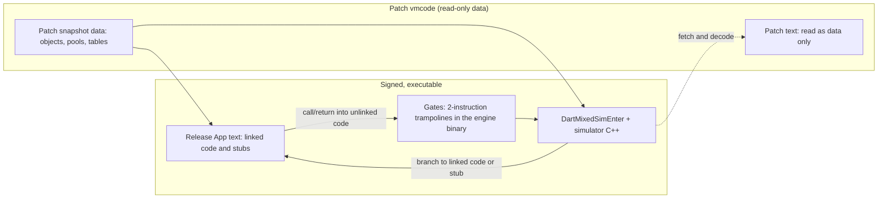

# iOS mixed-mode runtime: executing a linked AOT patch

Status: design plus a working host implementation (macOS arm64), 2026-11-04.
Owner of this doc: runtime worker. The compiler, linker and vmcode side lives
in `COMPILER_LINKER.md`; section 9 describes how the runtime consumes its
vmcode v1 output and where the two documents differ.

Code: `tony-cloud/dart-sdk` branch `tonycloud/ios-mixed-runtime-20261104`
(base `2513af5688a`, head `702d29f676c`; it merges the linker branch
`tonycloud/ios-aot-linker-20261104` at `86442b439ab`), worktree
`.agents/wt/runtime/dart-sdk`. The test program is in
`runtime/tests/mixed_mode/`; the repeatable test is
`tools/test_aot_mixed_mode.py` (section 10.5).

## 0. Verdict

**Go.** On the host, a patch AOT snapshot runs as follows:

- The patch's text is mapped **read-only**, so the CPU cannot execute any of it,
  just as on iOS.
- Every function whose machine code is unchanged runs from the release's
  signed native instructions.
- Changed functions and their direct callers run in the Dart VM's own ARM64
  simulator, compiled into the native runtime.

The spike passes these checks:

- calls in both directions;
- virtual (dispatch-table) calls and closure calls from native code into
  simulated code;
- exceptions crossing native and simulated frames in all three directions;
- 19 scavenges while simulated frames hold the only references to live
  objects;
- `async`/`await` in simulated code.

A stress mode that simulates all Dart code (94% of code bytes, everything
except the stubs) also passes. Linked code keeps native speed. Simulated code
is about 60–130× slower than native, which is in line with upstream's public
statements ("up to 100x", "~112x" for its first alpha).

**End to end with the real linker (section 10.5).** The runtime consumes the
linker's vmcode v1:

- `tools/ios_linker` builds the release and the patch, then runs link and
  check.
- The mixed runtime runs the vmcode against the stripped, signed Mach-O
  release. Its output equals a stock build of the patch.
- The runtime's linked and unlinked entry counts equal the linker's report.
- This holds for the template pair and all 14 cases of the 80/320-caller
  fixture, in Product (the iOS configuration: no compressed pointers),
  Release and Product with compressed pointers.

Every malformed or mismatched input falls back to the unpatched release
(19 cases, each checked for its reason).

Correctness came out simpler than feared because simulated and native frames
share one machine stack. Two things decide whether this is shippable:

- **performance** of unlinked hot code, which is determined by link quality,
  i.e. the compiler worker's layout alignment and the DD indirection, and by
  simulator speed;
- **engine integration**.

## 1. Model



- The VM deserializes **only the patch's** snapshot data: object store, class
  table, global object pool, dispatch table, and constants. The release's
  snapshot data is never deserialized; only its text is used.
- Every patch `Code` gets *native* entry points:
  - **linked**: the address of the identical code in the release text;
  - **unlinked**: a **gate**, a trampoline in the signed engine binary that is
    bound at load time to a patch pc.
- The CPU only ever branches to release text, engine text, or gates. The
  simulator fetches instructions from the patch text as data.

## 2. Which interpreter

**Recommendation: use the VM's own `simulator_arm64.cc`, extended for mixed
mode. Do not write a new interpreter now.**

Assessment of `runtime/vm/simulator_arm64.cc` at this revision:

- **It already builds into native arm64 binaries.** Upstream added
  `dart_force_simulator`, which defines `DART_INCLUDE_SIMULATOR` when host and
  target are both arm64, plus a runtime flag `--use_simulator`. It is used for
  the iOS 26 no-JIT debug fallback (`virtual_memory_posix.cc`:
  `FLAG_use_simulator = !can_jit`). That mode is all-or-nothing: every Dart
  call goes through `Simulator::Call` on a separate simulated stack, and
  runtime calls go through `Redirection` trampolines.
  - Mixed mode reuses the compile-time half (GN arg `dart_mixed_mode`, which
    defines `DART_INCLUDE_SIMULATOR`, `DART_MIXED_MODE` and `SIMULATOR_FFI`).
  - It sets `use_simulator` to default false. Every existing
    `FLAG_use_simulator` site then takes the native path.
- **It decodes everything AOT emits**, including LSE atomics
  (`DecodeAtomicMemory`) and SIMD, because Dart's simarm64 AOT CI runs on it.
  No missing instruction was hit, even when all of `dart:core`/`async`/
  `collection` ran under it (section 10.3).
- **It accesses host memory directly.** Its "memory" is the real heap. The
  weak-memory buffering (`--sim_buffer_memory`) is off by default. Unaligned
  accesses are allowed. Exclusive and atomic operations are implemented with
  real atomics, so simulated and native threads can share objects.
- **What mixed mode had to add** is small (section 10):
  - classify register branches and `bl`/`b` into "stay simulated" or "leave";
  - a `RunMixed(MixedRegs*)` entry and exit;
  - nothing else in the decoder.
- **Weakness: speed.** It is a decode-every-instruction switch interpreter:
  about 18–28 ns per simulated instruction on this host (section 11).

Alternatives considered:

| Option | Verdict |
| --- | --- |
| Custom pre-decoded / threaded ARM64 interpreter (decode once per instruction into a side table of handlers + operands) | Best long-term speed; typically 3–5× faster than a decode switch. Do it later behind the same `MixedBranch`/`RunMixed` interface; the rest of this design does not change. |
| Dart bytecode interpreter (our earlier route) | Rejected by the user: it needs a non-AOT release, which costs the 20× size and 1.5–3.9× slowdown. |
| Binary translation to anything executable | Impossible on iOS (no writable+executable memory). |
| Third-party ARM64 emulators (unicorn/QEMU, etc.) | Licensing (GPL) and integration cost; no benefit over the VM's own BSD simulator, which already understands Dart's ABI. No user decision is needed while we stay on the VM simulator. |

## 3. Execution model

### 3.1 One stack, flat simulator

- Simulated Dart frames live **on the ordinary thread stack**, interleaved with
  native Dart frames and linked by the same FP chain. The simulator's `SP`
  (R15) and `CSP` (R31) registers *are* the real values.
- The simulator's own C++ frames run on a separate per-thread **side stack**
  (512 KiB, `MixedMode::NewThreadArea`). Dart frames that simulated code
  pushes therefore never collide with the C++ that simulates them.
- The simulator is **flat**: it runs only while unlinked code executes and
  *returns to the CPU* for every branch to native code. Runtime calls,
  allocation stubs, write-barrier stubs, and type-testing stubs are all native
  code, so the simulator exits for them. Consequences:
  - The simulator never nests, and it holds no Dart state between activations;
    everything is in registers saved by the gate or on the shared stack.
  - Whenever the VM runs C++ (GC, safepoint, exception dispatch, runtime
    entries), there is no simulator activation at all. The stack is an
    ordinary stack whose only peculiarity is that some return addresses are
    gate addresses (section 6).
  - There is no `Redirection`/`hlt` machinery. C functions (leaf runtime calls,
    FFI) are reached natively through the same exit path.

### 3.2 Gates

- A gate is two instructions in the engine's signed `__TEXT`:
  `adr x16, . ; b DartMixedSimEnter`. The spike has 131072 of them (1 MiB),
  in `vm/mixed_mode_gates_arm64.S`.
- Each gate is bound once to a patch pc (`gate_target_[i]`); a lock-free hash
  map goes the other way (patch pc → gate).
- `x16` (IP0) is dead at every call and return boundary in both the Dart and
  the C ABI.

`DartMixedSimEnter`:

1. Loads `Thread::mixed_area_` via THR (x26).
2. Stores x0–x30, CSP and q0–q31 into the area.
3. Switches CSP to the side stack and calls `DartMixedRun(area)`.
4. `Simulator::RunMixed` loads the registers into the simulator, starts at
   `gate_target[x16]`, and runs until a branch leaves simulated code.
5. It stores the simulated state back into the area and returns the native
   target.
6. The assembly reloads every register (CSP included) and `br`s to the
   target. The area is heap memory, so reading it after `sp` moves is safe.

Flags (NZCV) are not carried; they are dead at every boundary where gates are
entered.

### 3.3 Branch classification inside the simulator

`Simulator::MixedBranch` handles `b`, `bl`, `br`, `blr` and `ret`. Conditional
branches never leave a function in Dart code.

1. A target inside the current unlinked entry: continue (cached
   `[sim_lo_, sim_hi_)`, so loops pay one compare).
2. A gate: continue at its bound patch pc.
3. A patch pc in an **unlinked** entry: continue simulating.
4. A patch pc in a **linked** entry, i.e. a `bl` from unlinked code to an
   unchanged callee: leave, at the *release copy*. Hot unchanged callees run
   natively even when called from simulated code.
5. Anything else (stubs, base code, C functions): leave.

**Return-address invariant.** Every return address the simulator produces is
CPU-executable. For `bl`/`blr`, LR is set to the *return gate* for the next
pc, even for simulated → simulated calls. On a non-linking exit (a tail call),
an LR that still holds a patch pc is converted to its gate. Frames therefore
never contain patch pcs.

The spike found that this invariant is necessary, not an optimization. The
first version kept patch pcs for simulated → simulated calls, and the CPU then
jumped into the read-only patch text in this case:

- the async `Suspend` stub returns, on behalf of the suspended function, to
  that function's caller;
- that caller was simulated, so the return address was a patch pc.

Any native code that unwinds or returns for a simulated frame has the same
problem. The gate rule removes the whole class of bug.

## 4. Native → simulated transitions (every way native code reaches code)

The guarantee comes from linking plus entry-point rewriting.

| Path | Mechanism |
| --- | --- |
| Direct `bl` (PC-relative) in release code | Never reaches unlinked code: the link rule (section 9) unlinks every entry with a PC-relative branch/`adr`/`adrp` into unlinked code, transitively (the caller cascade). |
| Dispatch-table call | The table is filled from `Code::EntryPointOf` during `ReadRoots`, after `ReadInstructions` has rewritten the entries, so unlinked targets hold gates. Verified: `sumAreas` (native) → `Circ.area` (simulated). |
| Switchable / monomorphic / IC calls | The miss handler writes `Code::MonomorphicEntryPoint()` (a gate or a release address) into the global pool. The initial `SwitchableCallMiss` entry is a linked stub. |
| Closures | `Function::entry_point_` and `Closure::entry_point_` caches are copied from `Code` in `PostLoad`, i.e. after rewriting. Verified with a tear-off and a lambda. |
| Type-testing stubs | `UpdateTypeTestingStubEntryPoint` reads the rewritten `Code` fields. |
| `InvokeDartCode` (C++ → Dart), FFI callbacks | C++ calls the *stub*, which must be linked: gates assume THR is in x26. VM stubs are identical for a given SDK build, and the linker must refuse a patch whose entry stubs differ. A simulate-everything mode that also unlinks stubs crashes here, as expected. |
| Exception handler resume | `JumpToExceptionHandler` stores the handler pc in `thread->resume_pc`, and `RunExceptionHandler` branches to it natively. Both it and `Exceptions::JumpToFrame` pass the pc through `MixedMode::ToNativePc` (release address or gate). |
| Async resume | The Suspend stub stores its raw (native) return address, a gate if the suspended function is simulated. Resume jumps to it. `SuspendState::Clone` copies the raw field, not the translated accessor. |
| Return into simulated code | A return gate, by the return-address invariant. |

## 5. Registers, pools, object store

- **THR (x26), NULL (x22), HEAP_BITS (x28), DISPATCH_TABLE (x21)**: the same
  values in both modes. The simulator simply carries the real register values.
  A thread interrupt (a stack-limit write) is seen by simulated overflow checks
  because they read THR memory.
- **PP (x27)**: the **patch's** global object pool, used by both linked
  release code and simulated code.
  - Linked release code is correct only because the compiler side keeps
    every pool index (and class id, field offset and dispatch offset) that the
    unchanged code uses at the release's value.
  - The *contents* of pool slots may differ. Upstream's "changed string, 100%
    linked" relies on exactly this. The bytes are identical; the object loaded
    is the patch's.
- **CODE_REG**: unused in bare-instructions AOT.
- **Dart SP (R15) and CSP**: real stack addresses (section 3.1). The CSP
  convention (`saved_stack_limit - 4096` in Dart code, SP-aligned across C
  calls) is preserved because the simulator runs the same instructions.
- **Object store and constants**: from the patch only. The release's snapshot
  data is not loaded. Only the release *text* must stay mapped; on iOS it is
  `App.framework/App`, which the engine has loaded anyway.

## 6. GC, stack walking, exceptions, safepoints, async, overflow, profiler

### 6.1 One rule: describe every frame by its patch pc

All metadata (stack maps, pc descriptors, exception tables, catch moves) is
keyed by offsets into the *patch's* instructions. `MixedMode::ToPatchPc` maps:

- a gate to its bound patch pc;
- a release-text pc to the patch pc at the same offset. In general this goes
  through the link records (per-entry deltas, section 9); identity linking
  (testing) uses deltas as well.

It is applied in:

- `StackFrame::GetCallerPc`;
- the explicit-pc `StackFrameIterator` constructor;
- the suspended-frame visitor (`UntaggedSuspendState`);
- `SuspendState::pc()`;
- `Code::PayloadStartOf`, so `pc - PayloadStart()` offsets are consistent.

Each is two range compares in a mixed build; non-mixed builds are unchanged.

### 6.2 Each subsystem

- **GC.** Safepoints happen only inside native stubs or the runtime, so there
  is no simulator state to scan. Stack maps of simulated frames are applied
  like any other frame's, because the frames are ordinary frames.
  - Verified: `changedGc` keeps 200 lists referenced only from its simulated
    frame and allocates both natively and while simulated. 19 moving
    scavenges ran during the test, then every list was verified.
  - The global pool and objects in the snapshot image are immovable.
- **Exceptions.** The handler search runs on translated pcs, and the handler
  is resumed through `ToNativePc`. Verified in all directions:
  - thrown in a native frame, caught in a simulated frame;
  - thrown in a simulated frame, caught in a native frame;
  - simulated → native → simulated throw, caught in the outer simulated frame.
- **Async.** Section 4. Verified with an `await` loop in a simulated function
  called from a simulated, async `main`.
- **Stack overflow.** One stack, so the normal `stack_limit` checks apply to
  simulated frames. The side stack is separate and bounded: the simulator does
  not recurse, and signal handlers run on it while simulating.
- **Profiler.** With `--profiler --profile_period=100` the spike runs
  correctly. Samples taken while simulating land in C++ simulator frames and
  are not attributed to Dart.
  - Production needs the sampler to detect "in simulator" (a flag in
    `MixedRegs`) and walk from the simulated FP/PC.
  - Dart frames below are already walkable via `top_exit_frame_info`.
- **Deoptimization.** Not applicable in AOT.
- **Debugger / service.** No breakpoints in AOT release builds.

## 7. Loading

`Deserializer` (`app_snapshot.cc`):

1. When the instructions table of the registered patch image is created
   (start pc, end pc and all entry offsets are known before any `Code` is
   read), `MixedMode::LinkImage` decides, for every entry, whether it is
   linked:
   - from the vmcode's link records (section 9), each verified against the
     code;
   - or, as a testing aid, by identity for a plain patch ELF.

   This runs before any cluster is allocated. If linking fails, the
   deserializer stops with "mixed-mode patch rejected: …" and the embedder
   creates the isolate group again from the release.
2. `ReadInstructions` rewrites `entry_point_`, `unchecked_entry_point_`,
   `monomorphic_entry_point_` and `monomorphic_unchecked_entry_point_`:
   - **linked**: release address;
   - **unlinked**: a gate per distinct address.

   Every later copy then inherits native addresses: the dispatch table
   (`ReadRoots`), `Function`/`Closure` entry caches and TTS entry points
   (`PostLoad`), and pool entries (runtime).
3. `InstructionsTable` stays in patch space, and `PayloadStartOf` translates,
   so `ReversePc`, stack maps and handler lookup are unchanged.

Embedder (host: `bin/main_impl.cc`, `MixedModeLoad`; production: the engine):

- Load the release normally (dlopen of the signed Mach-O).
- Read the patch. For a vmcode container, `ParseVmcode`:
  - validates the header and the zero padding;
  - checks the SHA-256 of the ELF;
  - checks the SHA-256 of the loaded release `_kDartSnapshotText` region,
    `release text image size` bytes long, against header offset 48.
- Map the patch ELF at the header's ELF offset, with its executable segment
  **read-only** (`elf_loader_map_text_read_only`).
- Call `Dart_MixedModeRegisterImages(patch_text, release_text, links,
  link_count, &error)` before the isolate group is created. It validates the
  records structurally.
- On any failure, run the release unpatched
  ("mixed: patch rejected (reason); running the release").

A mixed build must keep native `dlopen` loading. `snapshot_utils.cc` disables
it under `DART_INCLUDE_SIMULATOR` and maps the Mach-O by hand, which hardened
runtime kills (SIGKILL, no crash report). The spike fixes the guard for
`DART_MIXED_MODE`.

## 8. Soundness checklist

1. **Link rule.** An entry may be linked only if its bytes equal the release
   copy *and* every PC-relative reference (`b`, `bl`, `adr`, `adrp`) leaving it
   lands in a linked entry, iterated to a fixed point.
   - Identical bytes alone are not enough: `bl` targets the release's stale
     callee. The spike implements this in `LinkImage`.
   - The compiler-side linker owns the proof that layouts (cids, field offsets,
     pool indices, dispatch offsets, BSS/relocations) agree.
2. **Stubs that C++ enters** (`InvokeDartCode`, FFI callback trampolines,
   `RunExceptionHandler`, `JumpToFrame`, Suspend/Resume) must be linked. VM
   stubs only change with the SDK, so the linker should hard-fail otherwise.
3. **Gate capacity** is fixed at engine build.
   - Need: about 1–4 per unlinked entry, plus one per call site in unlinked
     code that executes, plus handler pcs.
   - Measured: 117 gates for the targeted patch, 3951 when simulating all Dart
     code.
   - Policy: 64–128K gates (0.5–1 MiB of text; the host build has 131072).
     The runtime refuses a patch when 4 × unlinked entries + call sites in
     unlinked code + 1024 exceeds the gate count, so it never runs out
     later. The refusal falls back to the release.
4. **One patch per process.** Gates are process-global. Isolate groups
   spawned from the same snapshot share them; a different snapshot never
   matches `IsPatchImage`.
5. **Integrity.** The simulator executes patch bytes. The engine must verify
   the vmcode hash/signature before mapping, as the updater already does for
   downloads. No writable+executable memory is created anywhere; all
   executable code is signed engine or App text.
6. **Thread safety.** Gate allocation is mutex-protected with lock-free reads.
   Each Thread has its own area, side stack and simulator.
7. **App Store policy** (guideline 2.5.2, interpreted code) is the same
   question upstream already faces with the same technique. This is not a
   technical blocker, and I am not giving legal advice.

## 9. Contract with the linker: consuming vmcode v1

The container is the one in `COMPILER_LINKER.md` section 6: a 128-byte
header, records `{patch_offset, release_offset, size, flags}` sorted by patch
offset (one per *linked* entry), zero padding, and the patch ELF at a
16 KiB-aligned offset.

What the runtime checks, all failing closed to the release:

| Where | Check | Reason printed |
| --- | --- | --- |
| Embedder | Magic `OSBVMC\0\x01`, length ≥ 128 | `bad vmcode magic` |
| Embedder | Version 1 | `unsupported vmcode version` |
| Embedder | Header fields: ELF offset (twice), alignment, entry size 16, links offset 128, flags 0, table ≤ ELF offset, ELF size | `malformed vmcode header` |
| Embedder | Padding all zero | `malformed vmcode padding` |
| Embedder | SHA-256 of the ELF (offset 80) | `vmcode ELF hash mismatch` |
| Embedder | SHA-256 of the loaded release text (offset 48) | `patch was linked against a different release` |
| `RegisterImages` | Records: flags 0, 4-byte aligned, sorted and disjoint, inside both images | `malformed link record`, `link records are not sorted or overlap`, `link record outside the patch or release image` |
| `RegisterImages` | A release image is mapped when there are records | `patch links release code but no release image is mapped` |
| `LinkImage` | Each record starts a patch instructions entry | `link record does not start a patch code entry` |
| `LinkImage` | Its size is the entry's payload; only `brk #0` alignment padding may follow | `link record size differs from the patch code entry` |
| `LinkImage` | Word-wise verification (below) | `linked code does not match the release copy` |
| `LinkImage` | Gate budget (section 8.3) | `patch needs more gates than the runtime provides` |
| After loading | `InvokeDartCode`, `JumpToFrame`, `RunExceptionHandler` and `FfiCallbackTrampoline` linked | `a stub entered from C++ is not linked to the release` |

**Word-wise verification.** The linker normalizes B/BL displacements, so the
patch and release bytes of a linked entry may differ in those words. For each
word of a linked entry the runtime requires one of:

- the words are equal and are not a pc-relative reference that leaves the
  entry;
- the word is a B or BL that leaves the entry, the release copy is the same
  kind of branch, and it reaches the release copy of a *linked* patch entry at
  the same offset.

Any other pc-relative reference leaving the entry (b.cond, cbz, tbz, ldr
literal, adr, adrp) rejects the patch. This re-checks the linker's rule 3 on
the device, with the bytes the CPU will execute. It cannot re-check layout
compatibility (pools, cids, field offsets), which is the linker's proof.

**Translation.** Linked entries have a per-entry delta (release − patch).
Release pcs map back to patch pcs through the linked release ranges, sorted
and binary-searched (`BaseToPatch`).

### 9.1 Notes against COMPILER_LINKER.md (root `558fe31`)

1. **Matches.** The record layout, the one-record-per-linked-entry coverage,
   payload offsets relative to `_kDartSnapshotText`, sizes equal to the
   payload, the VM-stub guarantee and the ADRP refusal all match. The runtime
   additionally refuses the patch itself when a C-entry stub is unlinked.
2. **Record size versus entry span.** A record's size is the payload. The
   instructions table only gives entry starts, so the runtime accepts a
   trailing gap of fewer than 16 bytes made of `brk #0` words (the last
   payload before the image end). It was found when the first real vmcode
   was rejected.
3. **Release hash.** Earlier, the linker hashed the ELF `_kDartSnapshotText`.
   The shipped Mach-O differs from the ELF in three `InstructionsSection`
   header words (`bss_offset`, `instructions_relocated_address`,
   `build_id_offset`; text offsets 0x50–0x67), so that hash never matched at
   runtime. The current linker (section 6.1) hashes the shipped Mach-O text,
   which is what the runtime hashes. Fixed upstream of this note.
4. **Mach-O `--base` input and symbols.** The linker bounds the text region
   by the next symbol in the section. gen_snapshot's direct
   `app-aot-macho-dylib` output keeps local function symbols even with
   `--strip`, so `link --base App.dylib` fails ("only 128 bytes before the
   next symbol"). Real App.frameworks are stripped by Xcode, and the test
   strips with `strip -x`. Using the sidecar size and ignoring local symbols
   would make the linker robust to unstripped input.
5. **Hashes cover the ELF and the release, not the header or records.** The
   runtime does not trust records: it validates them structurally and against
   the code (above). The engine should still verify a signature over the
   whole vmcode file before use.
6. **Host versus device.** iOS codegen differs from macOS in the write-barrier
   stubs (atomic memory is unsupported on iOS). Host results prove the
   mechanism, not iOS link percentages.

## 10. Spike

### 10.1 Changes (dart-sdk branch above)

| Area | Change |
| --- | --- |
| `vm/mixed_mode.{h,cc}` | Images, link decision, gates, pc translation, statistics, per-thread area |
| `vm/mixed_mode_gates_arm64.S` | Gates and `DartMixedSimEnter` |
| Simulator | `RunMixed`, `MixedBranch`, return-address invariant |
| VM hooks | Deserializer hooks; `PayloadStartOf`; stack-frame, suspend-state and resume pc translation; `Thread::mixed_area_` (appended after all generated-code fields, so offsets used by gen_snapshot are unchanged) |
| Build | GN `dart_mixed_mode` / `dart_mixed_area_offset` |
| Embedder | Read-only ELF text, release load, vmcode parsing and SHA-256 checks, `Dart_MixedModeRegisterImages`, retry with the release on rejection, native dlopen kept |
| Tests | `tools/test_aot_mixed_mode.py` (section 10.5) |

The spike's link table is computed in the runtime by identity: equal bytes at
equal image offsets plus the PC-relative closure. The base is the *same
program compiled with K=3* and the patch has K=5. Every edit is a same-size
immediate change, so both compiles share one layout. Production replaces this
with the compiler worker's table.

### 10.2 Commands (all exit 0 unless noted)

```
# Tree: .agents/wt/runtime/dart-sdk; SDK pinned to MacOSX14.0 (the 27.0 SDK's
# .tbd stubs are unreadable by this lld).
DART_GN_ARGS='mac_sdk_path="/Library/Developer/CommandLineTools/SDKs/MacOSX14.0.sdk"' \
  python3 tools/build.py -m release -a arm64 --no-rbe runtime_precompiled dart   # 131 s
ninja -C xcodebuild/ReleaseARM64 gen_snapshot dartaotruntime   # after VM edits (snapshot hash)
# xcodebuild/ReleaseMixedARM64/args.gn = ReleaseARM64 args + dart_mixed_mode = true,
#   dart_mixed_area_offset = 3904
gn gen xcodebuild/ReleaseMixedARM64 && ninja -C xcodebuild/ReleaseMixedARM64 dartaotruntime
# Spike dir .agents/wt/runtime/spike:
./gen.sh            # base: K=3 Mach-O dylib (signed); patch: K=5 ELF
dartaotruntime base.dylib                                   # native reference
DART_MIXED_BASE=$PWD/base.dylib DART_MIXED_VERBOSE=1 \
  ReleaseMixedARM64/dartaotruntime [--verbose_gc] patch.aot [n]
DART_MIXED_UNLINK_BELOW=0xad144 ...                         # stress: simulate all Dart code
```

### 10.3 Results

- **Link.** 3699 entries; 3685 identical; 6 cascade-unlinked; **20 unlinked
  (99.358% of code bytes linked)**. The unlinked set is exactly:
  - the changed functions, two implicit tear-off closures, `main`, and four
    `main` lambdas.
  - Earlier, `linkedCatcher`/`linkedPassThrough` were *also* unlinked: TFA
    saw a single closure target and turned `f(i)` into a direct
    `bl changedThrower`. This is the documented ripple effect, and the
    PC-relative cascade caught it correctly. The test now gives those
    helpers a second target.
- **Identical patch** (hello, same program as ELF patch vs Mach-O release):
  3650/3650 entries linked (100%), 0 transitions, correct output.
- **Functional (patch K=5): 11/11 PASS, exit 0.** The checks:
  - simulated leaf;
  - simulated → native calls;
  - dispatch-table call native → simulated;
  - closure tear-off and lambda native → simulated;
  - native helpers stay native;
  - exception native → simulated handler;
  - exception simulated → native handler;
  - simulated → native → simulated throw, caught in simulated code;
  - GC with simulated frames (19 scavenges, contents verified);
  - async/await in simulated code.
- **Patch text never executed by the CPU.** Before the `resume_pc` and
  return-gate fixes, the run died with `SIGBUS (BUS_ADRALN)` *at patch pcs*.
  That is the iOS-equivalent failure, and it shows the read-only mapping is
  enforced.
- **Stress** (`DART_MIXED_UNLINK_BELOW`): 3527/3699 entries simulated
  (5.9% linked: only stubs); 11/11 PASS; 18 scavenges; about 800K
  transitions; 3951 gates.
- **Profiler** (`--profiler --profile_period=100`): 11/11 PASS.

### 10.4 Performance

Host Apple Silicon. Release-mode runtimes, n = 20M, medians of 3 runs. The
native column runs the *release* natively (`ReleaseARM64/dartaotruntime
base.dylib`). The mixed column runs the patch (`ReleaseMixedARM64`).

| Benchmark | Native | Mixed | Ratio | Per op (mixed) |
| --- | ---: | ---: | ---: | ---: |
| `numLoopB` numeric loop, changed → simulated | 62.6 ms | 3601 ms | 57.6× | 180 ns/iter vs 3.1 |
| `numLoopN` same body, linked → native | 57.3 ms | 50.3 ms | 0.9× | native |
| `callLoopSimToSim` (5M calls, both simulated) | 6.2 ms | 698 ms | 113× | 140 ns/call |
| `callLoopSimToNative` (5M calls to a linked leaf) | 6.2 ms | 947 ms | 153× | 189 ns/iter |
| `callLoopNative` (linked caller, linked callee) | 10.3 ms | 7.1 ms | 0.7× | native |
| `applyN(changedLeaf)`: native loop, closure → simulated (5M) | 34.7 ms | 1052 ms | 30× | 210 ns/call |
| `applyN(tinyN)`: native → native closure | 26.8 ms | 20.3 ms | 0.8× | native |

What these numbers mean:

- **Linked code runs at native speed.** Ratios of 0.7–0.9× are noise: same
  instructions, same pool.
- **Simulated straight-line code costs about 18–28 ns per instruction**, the
  VM simulator's decode-every-instruction design.
- **A simulated → native → simulated round trip** costs about 50 ns over
  simulating the callee (189 vs 140 ns/iteration). A native → simulated → native
  round trip including simulating two tiny functions costs about 210 ns. Each
  costs a 63-register save/restore plus a hash lookup for the return gate.
- **Implication.** Hot code must stay linked. Performance work, in order:
  1. Link quality (compiler worker: layout alignment, DD indirection to cut
     cascades). This is by far the largest lever: a hot loop that stays
     linked is about 60–150× faster than the same loop simulated.
  2. Simulator speed: a pre-decoded or threaded interpreter, keeping the
     interface.
  3. Transition cost: save only the Dart-ABI-live registers (q8–q15 low halves
     are callee-saved; most q registers are dead at call boundaries). The
     return-gate and branch-target caches are done (section 10.6).

### 10.5 vmcode v1 end to end, fail-closed cases, configurations

`tools/test_aot_mixed_mode.py --release-dir <dir> --mixed-dir <mixed dir>
[--linker …/ios_linker.dart --dart <dart>] [--bench]` (macOS arm64). The
release dir provides gen_snapshot, dartaotruntime and vm_platform.dill.

**Part A** uses the template (release K=3, patch K=5, an unrelated release
K=4). It covers:

- the release run natively;
- the patch with identity linking (11/11 checks, with scavenges);
- the patch as a vmcode built from the runtime's own link records;
- the stress mode;
- 19 fail-closed cases. Each one must run the release (K=3, or K=4) and print
  the expected reason:
  - gate exhaustion;
  - truncated vmcode; bad magic; bad version; malformed header; nonzero
    padding;
  - ELF hash mismatch; a different release; a release hash mismatch;
  - record not at an entry start; record size mismatch; nonzero flags;
    overlapping records; record outside the release;
  - unmapped release (vmcode and identity);
  - C-entry stubs unlinked (no records, and identity "unlink all");
  - a record that links changed code.

**Part B** runs the linker at root `558fe31` (sidecar format 2) on each
release/patch pair:

1. Release: ELF and sidecar, plus a stripped, signed Mach-O dylib (the
   `--base`).
2. Patch: pass 1, `pool-hints`, constrained final build.
3. `link`, then `check`.
4. The mixed runtime runs the vmcode.

The test requires:

- the vmcode's release hash to equal the dylib text hash;
- output equal to a stock build of the patch;
- runtime linked/unlinked counts equal to `report.json`.

Pairs:

- the template (K=3 → K=5);
- a pure-Dart port of the 80- and 320-caller fixture, cases p0–p6
  (`run_matrix.py`'s fixture uses `dart:ui`).

`patch_perf_bench` is a Flutter app, so it is not practical on the host
runtime; it belongs with the device run.

Results: **38/38 PASS in each configuration**, exit 0.

| Configuration | Mixed runtime | Identity (template) | vmcode cases |
| --- | --- | --- | --- |
| Product, uncompressed (iOS configuration) | `ProductMixedARM64` (area offset 3864) | 1493 linked / 20 unlinked, 98.44% bytes | 15/15 |
| Release | `ReleaseMixedARM64` (3904) | 3679 / 20, 99.36% | 15/15 |
| Product, compressed pointers (robustness only) | `ProductMixedARM64C` (3872) | 1499 / 20, 98.45% | 15/15 |

Product (uncompressed) linker results. Runtime counts equal the report in
every row; output equals stock in every row.

| Pair / case | Linked | Unlinked | Linked bytes |
| --- | ---: | ---: | ---: |
| template K=3 → K=5 | 1493 | 20 | 98.44% |
| 80 callers p0 identical | 1541 | 0 | 100% |
| 80 p1 string | 1541 | 0 | 100% |
| 80 p2 one caller | 1537 | 4 | 99.15% |
| 80 p3 shared leaf | 1456 | 85 | 97.79% |
| 80 p4 field layout | 1456 | 85 | 97.79% |
| 80 p5 new function | 1539 | 3 | 99.90% |
| 80 p6 remove caller | 1537 | 3 | 99.18% |
| 320 callers p0 / p1 | 1781 | 0 | 100% |
| 320 p2 one caller | 1776 | 4 | 97.14% |
| 320 p3 shared leaf | 1456 | 325 | 92.03% |
| 320 p4 field layout | 1456 | 325 | 92.03% |
| 320 p5 new function | 1779 | 3 | 99.91% |
| 320 p6 remove caller | 1777 | 3 | 97.16% |

The Release configuration leaves 25 entries unlinked even for the identical
patch p0 (98.30%), against 0 in Product. That comes from the linker, and the
runtime agrees with it.

### 10.6 Simulator speed-ups

These are cheap and keep the decoder unchanged:

- a per-simulator branch-target cache (destination → simulated entry range,
  or native target);
- a return-gate cache;
- fast paths for `mov xd, xm` and 64-bit `ldr`/`str` with an unsigned
  offset.

All are guarded by a link generation counter. Product (compressed), median of
3, interleaved A/B runs:

| Benchmark | Before | After | Change |
| --- | ---: | ---: | ---: |
| `numLoopB` simulated arithmetic loop | 2976 ms | 2287 ms | −23% |
| `callLoopSimToNative` | 742 ms | 525 ms | −29% |
| `callLoopSimToSim` | 577 ms | 465 ms | −19% |
| `applyN(changedLeaf)` native → simulated closure | 1043 ms | 805 ms | −23% |

After these changes, the Product (uncompressed) mixed/native ratios are:

| Benchmark | Ratio |
| --- | ---: |
| `numLoopB` | 59.6× |
| `callLoopSimToNative` | 128× |
| `callLoopSimToSim` | 111× |
| `applyN(changedLeaf)` (native baseline 16.5 ms) | 37.5× |
| Linked code | 1.0× |

The profile is now spread over the bitfield, multiply, add/sub-shifted and
immediate decoders, so further fast paths give diminishing returns. The next
real step is a pre-decoded (or threaded) interpreter that caches decoded
instructions per entry. That is future work.

Side observation: with compressed pointers, the *native* closure-call loop
`applyN` takes 168 ms against 16.5 ms uncompressed. That is not a mixed-mode
cost, and iOS does not use compressed pointers.

## 11. Remaining work

### Runtime (dart-sdk)

Done:

- vmcode v1 consumption;
- fail-closed rejection;
- Product, Release and compressed configurations;
- the repeatable test;
- the first simulator speed-ups.

Next:

1. Make the profiler simulator-aware (section 6); sampling already runs
   correctly without it.
2. A pre-decoded or threaded interpreter, and leaner transitions (save only
   the Dart-ABI-live registers).
3. Deferred loading units: either refuse them in patches or link each unit,
   since `ReadInstructions` for deferred units goes through the same hook.
4. Turn `tools/test_aot_mixed_mode.py` into a CI step (it needs a macOS
   arm64 bot with the mixed and baseline builds).
5. Device: the iOS engine build with `dart_mixed_mode`, and a run of
   `patch_perf_bench` on the iPad (coordinator-scheduled).

### Engine (`flutter/engine/src/flutter`)

1. `runtime/shorebird/patch_cache.{h,cc}` / `patch_mapping.{h,cc}`:
   - map the downloaded vmcode **read-only**;
   - parse the link header;
   - locate the ELF;
   - verify its hash before use.
2. `runtime/dart_snapshot.cc`:
   - for iOS with a patch, take isolate data from the patch and keep the
     release `App.framework/App` text mapped;
   - pass both images to `Dart_MixedModeRegisterImages`, or an
     engine-friendly variant that also takes the link table, before
     `Dart_CreateIsolateGroup`.
3. Build: `dart_mixed_mode = true` for the iOS engine runtime only. Never set
   it for gen_snapshot. The gate offset (`dart_mixed_area_offset`) must be
   generated or checked by the build, not hand-set.
4. Fallback: on any rejection, boot the release unpatched and report to the
   updater. The host embedder shows the shape: reject before the isolate
   group, or retry `Dart_CreateIsolateGroup` with the release when the
   deserializer reports "mixed-mode patch rejected".
5. Device validation on iPad: signed IPA, release mode, frame timings. This
   is scheduled by the coordinator, not done here.

### CLI / linker

1. "Hot unlinked" warnings. The link-percent gate and stub hard-fail exist
   (exit codes 3 and 2).
2. A gate-budget check at link time, mirroring section 8.3.
3. Accept unstripped Mach-O releases (section 9.1, note 4).

## 12. Risks

| Risk | Severity | Mitigation |
| --- | --- | --- |
| Hot code unlinked by cascades (TFA/inlining) → 30–150× slowdowns | High (user-visible jank) | DD indirection, layout alignment, CLI warnings; upstream reports about 9/10 patches unaffected |
| Simulator speed | Medium | Pre-decoded interpreter (3–5× expected) |
| Hidden native consumers of patch addresses, like `resume_pc`, the async `Suspend` return and `SuspendState::Clone` | Medium | Return-gate invariant, plus all entry fields rewritten at the source. Stress mode (all Dart code simulated) is the regression net |
| Layout drift between release and patch makes "identical bytes" use wrong pools or cids | High if wrong | Compiler-side proof plus link rule; runtime byte re-check in debug |
| Gate exhaustion | Low | Budget check when linking; fail closed (tested) |
| Malformed or mismatched vmcode | Low | Hashes plus structural and word-wise record checks; fail closed (19 tested cases) |
| App Store policy | Not technical | Same technique as upstream; product decision |
| Build fragility: `DART_INCLUDE_SIMULATOR` side effects (snapshot loader guard), hardened runtime, the 27.0 SDK `.tbd`/lld mismatch | Low | Guards fixed; SDK pinned |

Left running: nothing.
